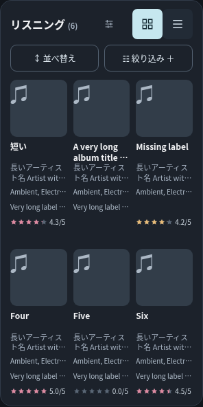
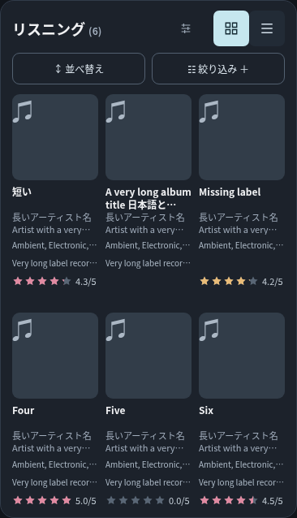
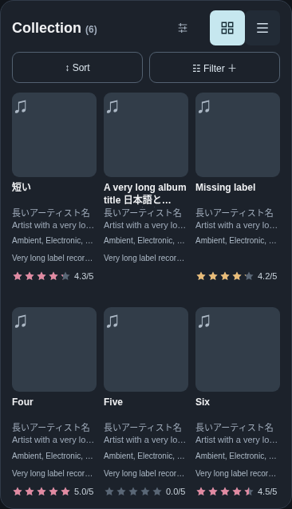

# PR #35 アーカイブヘッダーの左右配置・背景の調査

2026-11-10。基準はPR #35の `1356248c92678f5ddc82f4c54d69c4b513986326`。同一ブランチ `feat/archive-display-options` で調査・証跡を追加。

## 結論と変更範囲

**MLA側の左右配置・ヘッダー背景に修正を要する問題は再現しなかったため、アプリのHTML・CSS・JavaScriptは変更していない。** 今回はDOM/CSS・画素・操作の検証、パネル全体の画像、報告書を追加する。

実アプリは既に `.archive-heading` の `display:flex; align-items:center; justify-content:space-between` により、左のタイトル・件数と右の `.archive-controls` を独立領域として配置している。タイトル左端とヘッダー内側左端、グリッド／リスト右端と内側右端が全条件で一致した。操作群を中央寄せする指定はない。Flexの余白配分で左右を揃えており、タイトルと操作群を固定の余白で押し離していない。`gap` は衝突を防ぐ最小間隔として働く。

ヘッダー・操作群・見出しは背景色 `rgba(0, 0, 0, 0)`、背景画像 `none`、影 `none`、上下左右の枠線 `0px`。`::before` / `::after` の `content` は `none`。帯や編みがけを描く要素は存在しなかった。画素はヘッダーの空き領域・パネルの左右余白・ヘッダー下の余白すべてで `(28,34,43)`＝既存パネル背景 `#1c222b` と一致する。

前回提出したヘッダー単体画像は、パネル背景の一部を高さ44pxで矩形に切り抜いている。その画像自体が細長い帯として表示される構図であり、ヘッダー専用の装飾を示してはいない。今回のパネル全体画像では背景の連続性と既存パネルの枠線・角丸が確認できる。**GitHub画像ビューアの背景・枠線・オーバーレイは直接調査していないため、GitHubを原因と断定しない。** 実アプリに問題が存在しないという確認を根拠として、不要なCSS修正を避けた。

## 確認したCSS（変更なし）

|箇所（index.html）|実装・実測|
|---|---|
|`.panel`（4行目）|既存背景 `#1c222b`、枠線 `#313b49`、角丸17pxを維持|
|`.archive-heading`（128行目）|Flex、左右配分 `space-between`、縦中央揃え。背景・枠・影なし|
|`.archive-controls`（196行目）|Flex、設定→グリッド／リスト、独立間隔12px|
|`#display-options`（197–199行目）|44×44px、透明・枠なし・角丸なし、`#a1adbc`、16pxアイコン、キーボード時2pxアウトライン|
|狭幅調整（200–201行目）|既存の340px以下の見出し16px・件数11pxを維持。375px以上は見出し18px・件数12px|
|`.view-segments` / `.tab`|従来のグリッド／リストの一体化・選択色・18pxアイコンを維持|

全アプリソースを基準コミットとバイト単位で比較する試験を追加し、一致を確認した。設定モーダル、保存キー・形式、カード／リスト／Live、Insights、検索、DB、JSON／CSV、保存保護を変更していない。

## DOM実測と機能確認

Chromiumで日英×320/375/390/430px×Listening/Collectionの16条件を確認。Liveは追加8条件。隔離した合成レコード（アルバム各6件、Live1件）、外部通信遮断で実施。

以下は代表の日本語Listening。座標はビューポートのx座標。件数・文字を非表示にせず、文字領域全体が操作群より左に収まることも検証した。

|画面幅|見出し左端|ヘッダー左端|操作右端|ヘッダー右端|見出し|件数|操作領域|独立間隔|
|---|---|---|---|---|---|---|---|---|
|320|27px|27px|293px|293px|16px|11px|44×44px|12px|
|375|27px|27px|348px|348px|18px|12px|44×44px|12px|
|390|27px|27px|363px|363px|18px|12px|44×44px|12px|
|430|27px|27px|403px|403px|18px|12px|44×44px|12px|

- 全条件で1行・左右端揃え・タイトルと件数の非切断・非重複・横スクロールなし。見出しの太さ700は前回から不変。
- 設定アイコンの16px、透明・枠なし、独立間隔12px、主要切り替えの選択色を維持。Shift+Tabでのフォーカス表示、Enterでモーダルを開きEscapeで閉じる操作、グリッド／リスト切り替えが成功。
- 実アプリは無変更のため、調査前後のパネル画像・ヘッダー画像・DOM寸法・CSSが全条件で一致。Liveも同様。
- 操作後のレコードDB文字列・表示設定文字列が一致。DB書き込みは0回。
- [ブラウザ試験ログ](archive-header-audit/browser.log)、[DOM寸法・CSS・背景画素JSON](archive-header-audit/measurements.json)、[Node全151件成功ログ](archive-header-audit/node-tests.log)。

## パネル全体による重点確認

以下はGitHubビューアのスクリーンショットではなく、ローカルHTTPサーバー上のMLAをChromiumで直接描画して撮影した未加工PNG。各組の「調査前」「確認後」はソース無変更のため同じ描画になる。切り抜き画像だけを根拠にしていない。

### 320px・日本語・Listening

調査前:

確認後:

### 390px・日本語・Listening

調査前:

確認後:

### 390px・英語・Collection

調査前:

確認後:

目視でも、タイトル左寄せ、操作群右寄せ、既存パネルから連続する背景、主要切り替えに対する設定アイコンの控えめな存在感を確認した。

## 全条件の比較画像

Listening/Collectionのパネル全体32枚・ヘッダー32枚、Live比較32枚を保存。重点3条件ではページ全体の前後6枚も追加。

|幅|言語|Listeningのパネル全体|Collectionのパネル全体|Liveのパネル全体|
|---|---|---|---|---|
|320|ja|[調査前](archive-header-audit/before-panel-listening-ja-320.png) / [確認後](archive-header-audit/after-panel-listening-ja-320.png)|[調査前](archive-header-audit/before-panel-collection-ja-320.png) / [確認後](archive-header-audit/after-panel-collection-ja-320.png)|[調査前](archive-header-audit/before-panel-live-ja-320.png) / [確認後](archive-header-audit/after-panel-live-ja-320.png)|
|320|en|[調査前](archive-header-audit/before-panel-listening-en-320.png) / [確認後](archive-header-audit/after-panel-listening-en-320.png)|[調査前](archive-header-audit/before-panel-collection-en-320.png) / [確認後](archive-header-audit/after-panel-collection-en-320.png)|[調査前](archive-header-audit/before-panel-live-en-320.png) / [確認後](archive-header-audit/after-panel-live-en-320.png)|
|375|ja|[調査前](archive-header-audit/before-panel-listening-ja-375.png) / [確認後](archive-header-audit/after-panel-listening-ja-375.png)|[調査前](archive-header-audit/before-panel-collection-ja-375.png) / [確認後](archive-header-audit/after-panel-collection-ja-375.png)|[調査前](archive-header-audit/before-panel-live-ja-375.png) / [確認後](archive-header-audit/after-panel-live-ja-375.png)|
|375|en|[調査前](archive-header-audit/before-panel-listening-en-375.png) / [確認後](archive-header-audit/after-panel-listening-en-375.png)|[調査前](archive-header-audit/before-panel-collection-en-375.png) / [確認後](archive-header-audit/after-panel-collection-en-375.png)|[調査前](archive-header-audit/before-panel-live-en-375.png) / [確認後](archive-header-audit/after-panel-live-en-375.png)|
|390|ja|[調査前](archive-header-audit/before-panel-listening-ja-390.png) / [確認後](archive-header-audit/after-panel-listening-ja-390.png)|[調査前](archive-header-audit/before-panel-collection-ja-390.png) / [確認後](archive-header-audit/after-panel-collection-ja-390.png)|[調査前](archive-header-audit/before-panel-live-ja-390.png) / [確認後](archive-header-audit/after-panel-live-ja-390.png)|
|390|en|[調査前](archive-header-audit/before-panel-listening-en-390.png) / [確認後](archive-header-audit/after-panel-listening-en-390.png)|[調査前](archive-header-audit/before-panel-collection-en-390.png) / [確認後](archive-header-audit/after-panel-collection-en-390.png)|[調査前](archive-header-audit/before-panel-live-en-390.png) / [確認後](archive-header-audit/after-panel-live-en-390.png)|
|430|ja|[調査前](archive-header-audit/before-panel-listening-ja-430.png) / [確認後](archive-header-audit/after-panel-listening-ja-430.png)|[調査前](archive-header-audit/before-panel-collection-ja-430.png) / [確認後](archive-header-audit/after-panel-collection-ja-430.png)|[調査前](archive-header-audit/before-panel-live-ja-430.png) / [確認後](archive-header-audit/after-panel-live-ja-430.png)|
|430|en|[調査前](archive-header-audit/before-panel-listening-en-430.png) / [確認後](archive-header-audit/after-panel-listening-en-430.png)|[調査前](archive-header-audit/before-panel-collection-en-430.png) / [確認後](archive-header-audit/after-panel-collection-en-430.png)|[調査前](archive-header-audit/before-panel-live-en-430.png) / [確認後](archive-header-audit/after-panel-live-en-430.png)|

ヘッダー画像は同じディレクトリの `{before|after}-header-{listening|collection|live}-{ja|en}-{width}.png`。

ページ全体:

- [320px日本語Listening 調査前](archive-header-audit/before-page-listening-ja-320.png) / [確認後](archive-header-audit/after-page-listening-ja-320.png)
- [390px日本語Listening 調査前](archive-header-audit/before-page-listening-ja-390.png) / [確認後](archive-header-audit/after-page-listening-ja-390.png)
- [390px英語Collection 調査前](archive-header-audit/before-page-collection-en-390.png) / [確認後](archive-header-audit/after-page-collection-en-390.png)

## 未検証・提出

- iPhone Safari実機・VoiceOver・実タッチは未検証。今回の描画・寸法・操作確認はChromium。
- GitHub画像ビューアの描画は直接検証しておらず、表示上の違和感の原因をGitHubと断定しない。
- 初回報告に記載した既存試験4本の失敗は今回の対象外。アプリのソースが不変であるため、今回の再実行は背景・配置・操作・データ非変更のブラウザ試験とNode全件に限定した。
- PR #35の同じブランチへ報告と証跡を追加し、再レビューを依頼する。新規PR・マージ・手動デプロイは実施しない。
