# MLA アーカイブ見出し削除・言語選択中央揃え

基準: 最新 main `1eedc61736f69946b659fefa65aa63969cf62e71`（PR作成前にリモート参照も再確認）。専用ブランチ: `fix/archive-headings-language-alignment`。

## 差分

- `index.html`: 共通のアーカイブ見出し行に既存の `sr-only` を適用し、Listening／Collection／Live の見出しと行の高さを視覚レイアウトから除去。件数は `hidden`。領域名の見出しと `library-title` IDを残し、`archive-panel` に `aria-labelledby` を追加。年別見出しと表示設定ボタンは従来どおり。
- 最下部の `#ui-language` だけに `text-align`／`text-align-last: center` と左右22pxの均等余白を指定。幅104pxで16pxのEnglishも収まり、右側に独立した矢印を配置。閉じたselectの外観のみ変更し、ネイティブの選択操作・イベント・保存処理は維持。
- 検証コードと証跡を追加。既存操作バー試験の「外側タップ」対象を、削除対象の見出しからブランド領域へ変更。

アプリのJavaScript・操作バー・保存構造・検索・統計処理は変更なし。

## 検証条件と結果

Chromium／Linux Playwright WebKit 26.5、390×844（タッチ設定）および1280×844、日本語・英語。新規ブラウザコンテキストと合成記録を使用。外部通信は遮断し、検索はモック応答でUI経路を確認。

| 項目 | 結果 |
| --- | --- |
| 3領域の見出し・件数・不要な見出し行の除去 | PASS |
| 削除前との年別見出し位置比較 | 全領域・両幅・両エンジンで日本語26px／英語21px上へ移動 |
| ジャケット／カード寸法・検索パネル位置と寸法 | 削除前と一致 |
| 年別見出し・表示設定ボタン／ダイアログ | PASS |
| 見出しのアクセシビリティツリー残存・領域ラベル・参照ID | PASS |
| 日本語・Englishの中央揃え／矢印との非重複 | CSS検査と390pxスクリーンショット目視でPASS |
| 他selectへの中央揃え波及なし | PASS |
| 言語即時反映・再読み込み後の保持 | PASS |
| Listening／Collection手動登録・IndexedDB永続化 | PASS |
| 検索UI・Live追加・統計切替・グリッド／リスト・ソート／フィルター保持 | 既存 archive_toolbar.py で確認 |
| 下部バー収納・展開・キーボード・パネル開閉・先頭ボタン | 既存 retractable_toolbar.py で確認 |
| CRUD・JSON往復・復旧保護・左右スワイプ・先頭ボタン | 既存 mobile_navigation.py で確認 |
| Pull to Refresh／standalone／display-mode | 既存 pull_refresh_modes.py で確認 |
| 既存Node回帰試験 | 164件すべて成功 |

実行コマンド:

```sh
node --test tests/*.test.cjs
python -u tests/archive_heading_language.py
python -u tests/archive_toolbar.py
python -u tests/retractable_toolbar.py
python -u tests/mobile_navigation.py
python -u tests/pull_refresh_modes.py
git diff --check
```

WebKitは `/tmp` にブラウザと不足ライブラリを展開し、`MLA_WEBKIT=/tmp/mla-browsers/webkit-2336/pw_run.sh` を指定。OS設定・パッケージは変更していません。再実行環境では対応するPlaywrightブラウザと依存ライブラリが必要です。

**iPhone実機は未検証**。iPhone Safariでの閉じたselectの描画、iOS標準選択UI、VoiceOver、実機タッチ／セーフエリアは未検証です。Linux WebKitのモバイル設定や合成タッチイベントは実機確認の代替にはしていません。

## 390px スクリーンショット

| 画面 | Chromium 日本語 | Chromium English | WebKit 日本語 | WebKit English |
| --- | --- | --- | --- | --- |
| listening | 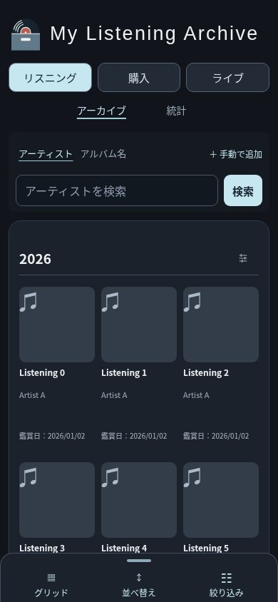 | 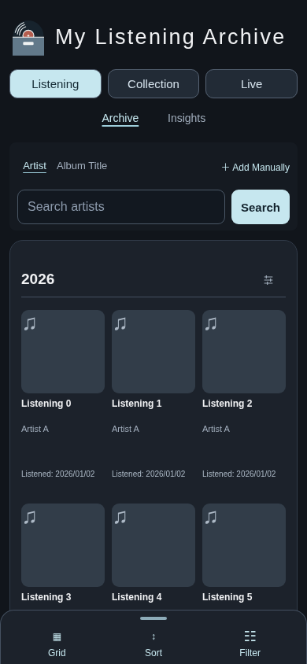 | 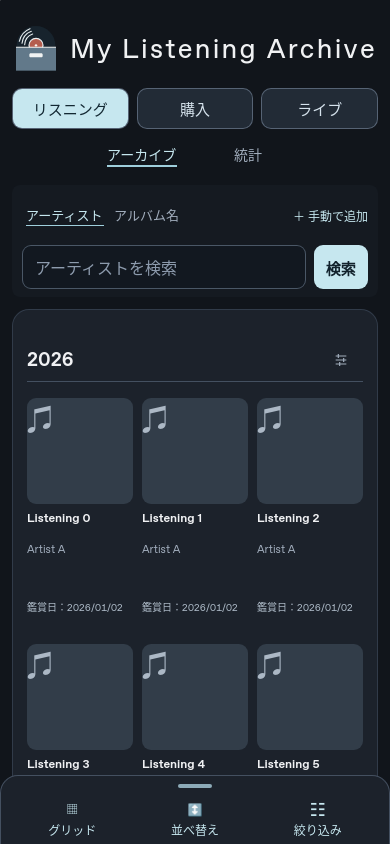 | 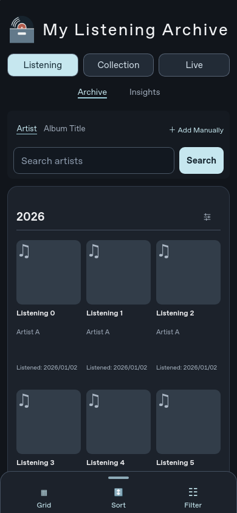 |
| collection | 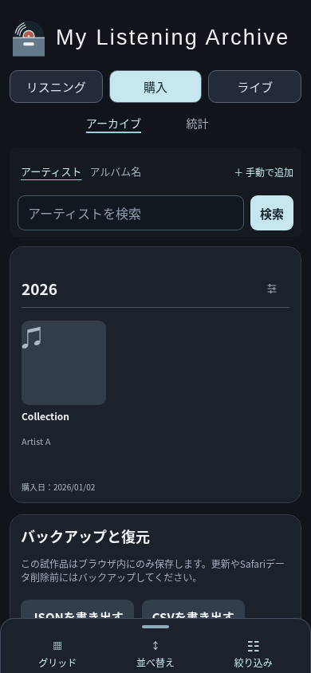 | 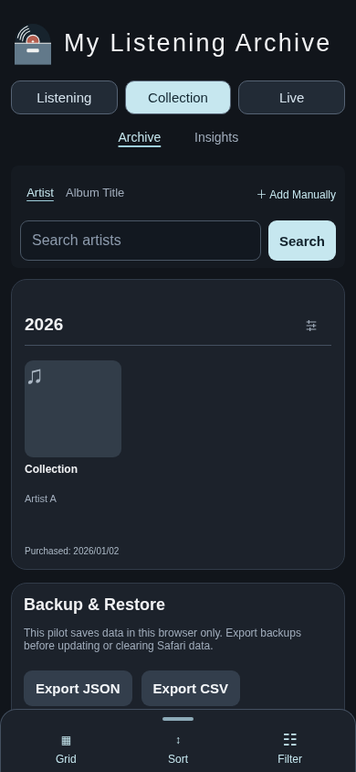 | 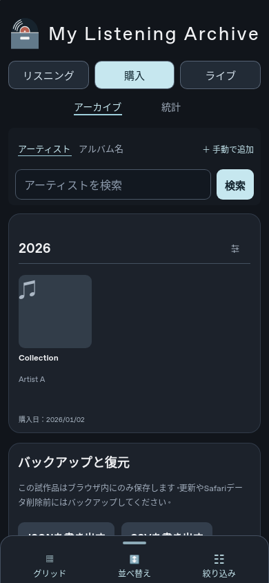 | 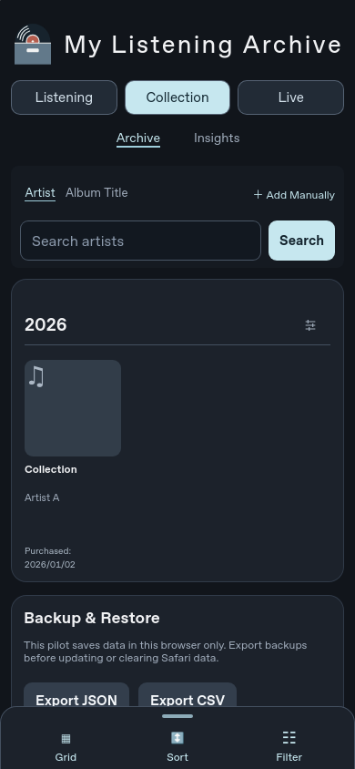 |
| live | 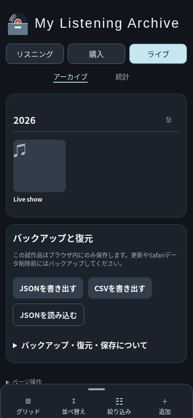 | 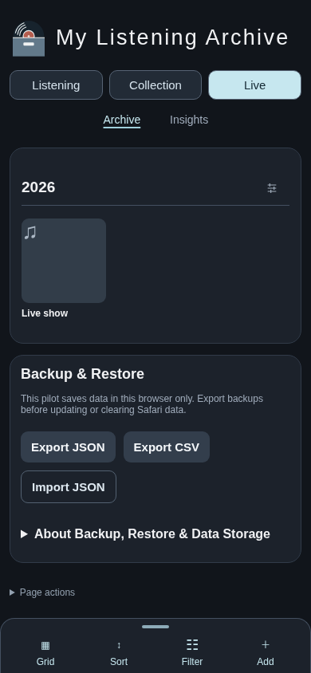 | 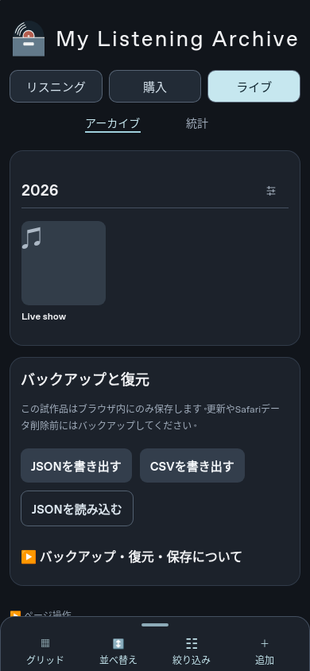 | 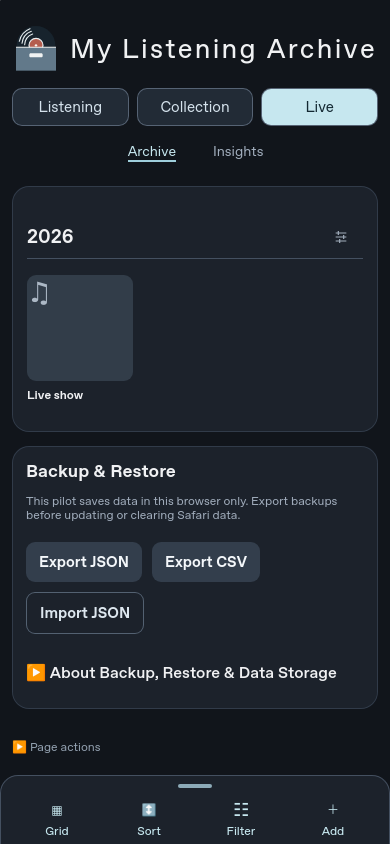 |
| language | 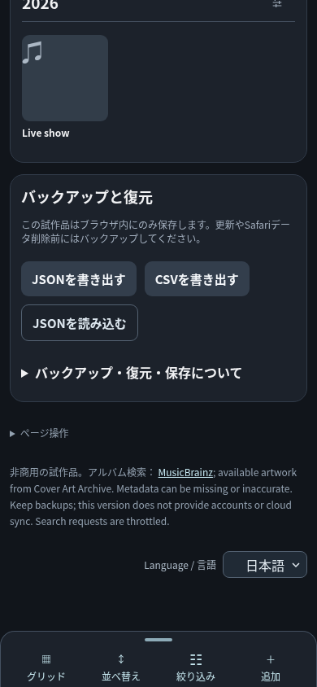 | 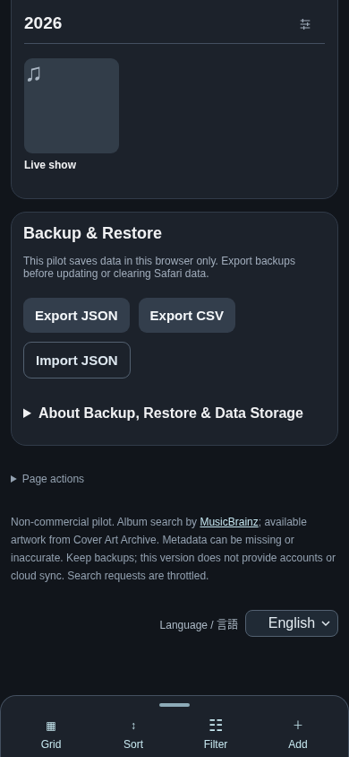 | 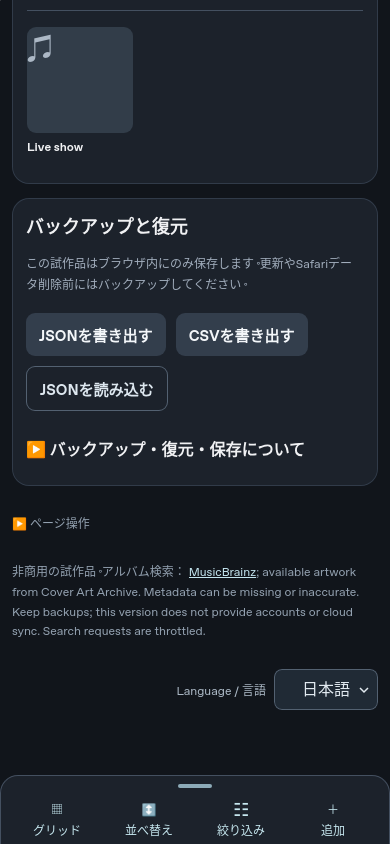 | 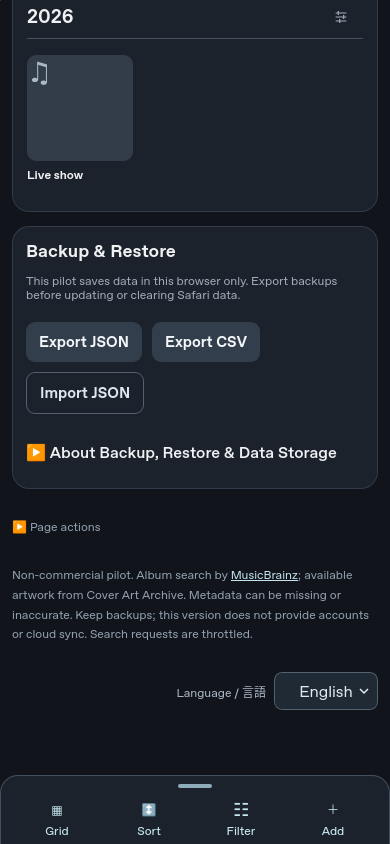 |

検証ログ: [Node](node-tests.log)、[今回の表示・アクセシビリティ](heading-tests.log)、[既存操作バー](toolbar-tests.log)、[収納式バー](retractable-tests.log)、[ナビゲーション・保存](mobile-tests.log)、[Pull to Refresh](pull-tests.log)。

mainへのマージ・正式環境への反映は行わず、PRレビュー待ちとします。
