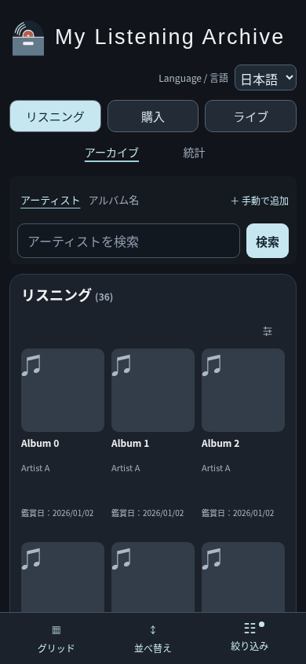
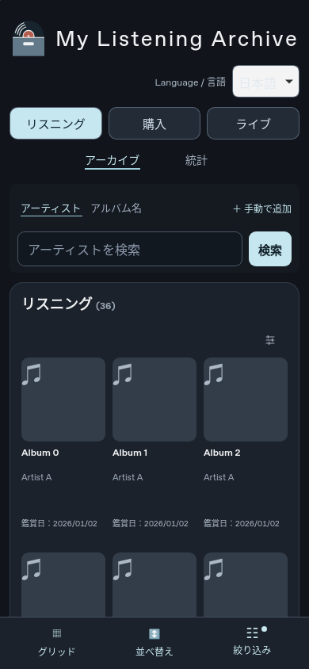
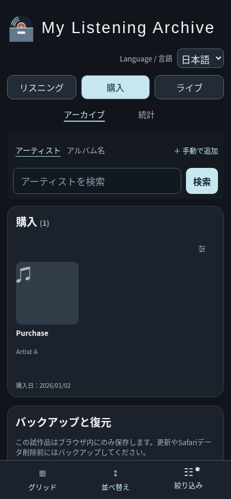
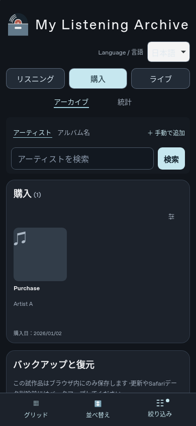
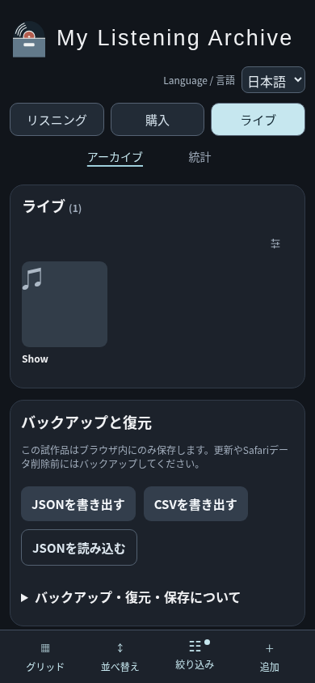
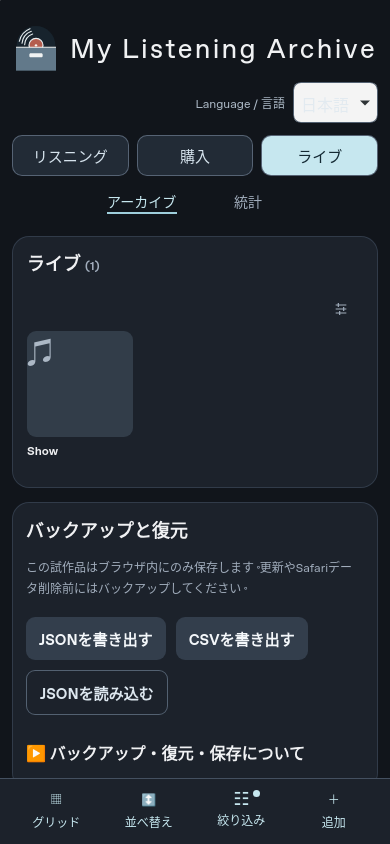
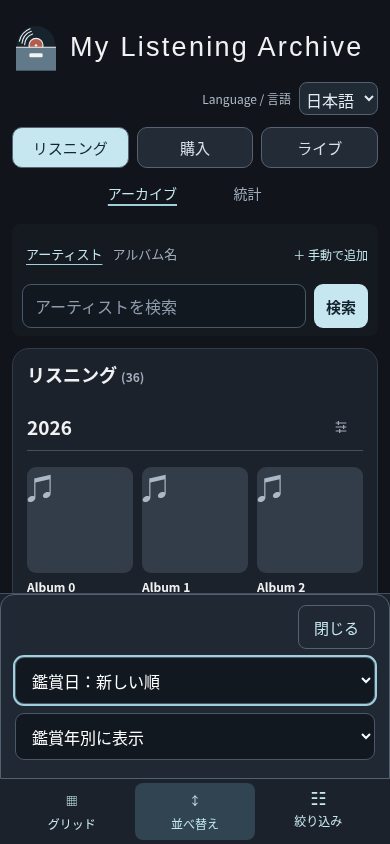
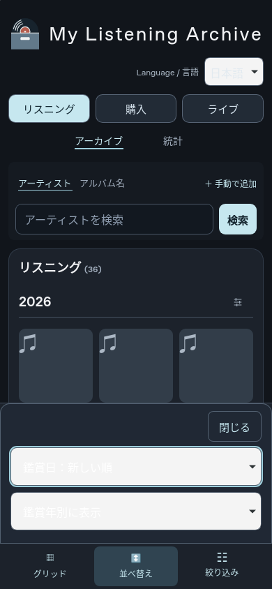
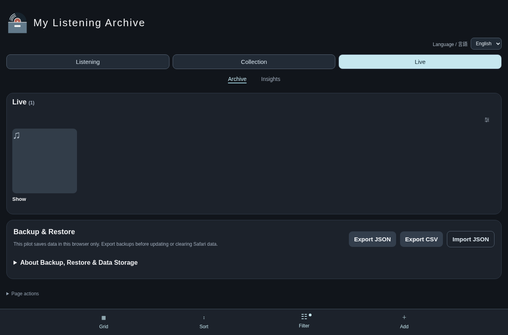
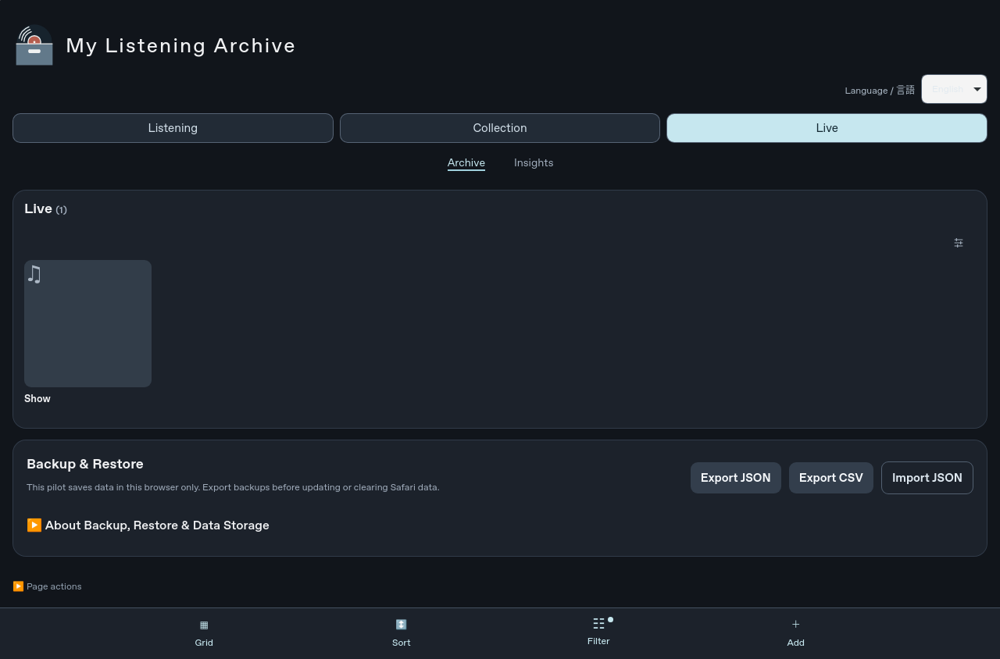

# MLA 固定下部操作バー 改修報告

## 変更

最新main `87f5f3b3abded04de8b58108569c07e7f916b9f3` を基準に `feat/archive-bottom-toolbar` を作成。mainへのマージ・正式環境への反映は実施していません。

Listening／Collectionは「表示切替・並べ替え・絞り込み」、Liveは加えて「＋追加」を下部に配置しました。表示切替は現在の状態（グリッド／リスト）をアイコンとラベルで表示し、タップで既存の `view()` を呼びます。

既存の並べ替え・絞り込みselectとLive追加ボタンをDOMごと移動し、イベントハンドラー・選択肢・条件保持・登録フォーム・保存処理を再利用しています。フィルター適用時は水色の点と読み上げラベルで状態を示します。選択パネルはバーの上で開き、スクロール可能です。閉じる／Escape／外側タップで閉じ、条件を保持します。Escapeと閉じるボタンは起動ボタンにフォーカスを戻します。

バーは66px＋セーフエリアで、本文末尾に専用の余白を確保しています。横幅の広い画面では操作領域を既存の本文幅に揃えます。統計・モーダル表示中は非表示。先頭へ戻るボタンはバー（選択パネルを含む）の実測高より上に置き、既存の400px判定・3秒タイマー・フォーカス処理には変更していません。

上部の検索・手動追加、両タブ群、見出し・件数、カード、表示項目設定は維持しています。IndexedDB、移行・復旧、JSON、登録・編集・削除、統計、スワイプ、Pull to Refreshの実装は変更していません。追加ファイルは `archive-toolbar.js` と `archive-toolbar.css`。`index.html` は読込・初期化と既存翻訳処理の並べ替えラベル改行のみ変更しました。

## 検証

すべて新規ブラウザコンテキストと合成データで実施。外部APIは遮断し、検索試験は空結果のモックを使用。実データ・正式環境は使用していません。

| 項目 | 結果 |
| --- | --- |
| Chromium・WebKit、390×844／1280×844、日英、3領域 | PASS |
| アーカイブで表示／統計で非表示、上部ボタン重複なし | PASS |
| グリッド／リスト切替、状態表示 | PASS |
| 日付昇順・グループなし、ジャンル／店舗／会場フィルター、開閉・領域往復で保持 | PASS |
| フィルター適用表示 | PASS |
| Live既存追加フォーム、保存後の再読み込み（IndexedDB） | PASS |
| Listening／Collection検索フォームのモック検索、手動追加起動 | PASS |
| 既存3領域CRUD、JSON往復、復旧・保存失敗時保護 | PASS（既存回帰試験） |
| ボタン幅・高さ44px以上、ラベル横はみ出しなし | PASS |
| 最下部footerがバーより上に表示できること | PASS |
| 先頭へ戻るボタンの重なり、3秒後非表示・再スクロールで再表示 | PASS |
| キーボード・フォーカス・モーダル競合防止 | PASS（DOM／自動操作） |
| 横スワイプ、縦・斜め・端・複数指・キャンセルの除外 | PASS（合成イベント） |
| 通常ブラウザ／standalone指定／display-mode指定のPull to Refresh | PASS（両エンジン各4条件） |
| セーフエリア34px相当をCSSで代入した高さ検証 | PASS（実機測定ではない） |
| 既存Node回帰試験 | 164件 PASS |
| `git diff --check` | PASS |

再実行コマンド：

```sh
node --test tests/*.test.cjs
python -u tests/archive_toolbar.py
python -u tests/mobile_navigation.py
python -u tests/pull_refresh_modes.py
```

WebKitの既定実行ファイルが利用できない環境では `MLA_WEBKIT=/path/to/pw_run.sh` を指定します。本環境では不足共有ライブラリを一時領域のWebKit複製に追加して実行しました。検証ツールのシステム依存関係はリポジトリへ含めていません。

## スクリーンショット

全体はこのディレクトリの `エンジン-幅-言語-領域.png`（24枚）、選択パネルは `エンジン-領域-sort.png`（6枚）。すべて合成データです。

| | Chromium | WebKit |
| --- | --- | --- |
| Listening・日本語390px |  |  |
| Collection・日本語390px |  |  |
| Live・日本語390px |  |  |
| 並べ替えパネル |  |  |
| Live・英語1280px |  |  |

## 残存リスク・未検証

iPhone実機のSafari／ホーム画面起動、ホームインジケータの実際の余白、ブラウザツールバー伸縮、ソフトウェアキーボード／日本語IME、VoiceOver読み上げとネイティブジェスチャーは未検証です。Linux WebKitと合成イベントはこれらの代用にはなりません。実機での最終レビューが必要です。

選択UIは既存のネイティブselectを再利用し、入力欄を追加していません。パネルは55dvhまでのスクロール領域に収めていますが、iOSのネイティブ選択ピッカーとキーボードの切替挙動は実機で確認してください。検索の実API疎通は今回の隔離試験では実施していません。
