# MLA アーカイブ上部余白・言語選択文字位置

基準main: `3a50e8392e33631961d234cb6bd494e78dfca53f`。専用ブランチ: `fix/archive-top-spacing-language-position`。

## 原因と変更

アーカイブの非表示見出しは既に絶対配置の1px要素で、通常フローの高さを占めていませんでした。操作要素は既存の下部バーへ移動済みで、パネル内には非表示見出しと一覧だけが残っています。一覧の `margin-top:12px` と先頭年別見出しの `margin-top:16px` が相殺（大きい方の16pxになるマージンの折り畳み）され、パネルのpaddingとは別に16pxの空きが残っていました。

`#library` と `#library > .section:first-child` の上マージンだけを0にします。負のマージンや位置の固定補正は使っていません。パネル内の上端から年別見出しのボックス上端までが29px→13pxとなり、既存の上padding12px＋border1pxだけになります。年別見出し自身のpadding、下マージン、2年目以降の間隔は変更していません。アクセシブルな見出し・領域ラベル・表示設定ボタンも保持します。

言語selectは `padding-inline:22px` を0にし、`text-indent:0` を明示しました。`text-align:center`／`text-align-last:center` は維持し、文字配置を左右のpaddingに依存しない形にしています。幅104px・高さ・角丸・色・独自矢印の位置、項目全体の右寄せ、ネイティブselectと選択操作は維持。DOM・アプリのJavaScript・操作バー・保存処理に変更はありません。

**iPhoneで報告された文字の右寄りはLinux Chromium／WebKitでは再現しませんでした。** 両エンジンでは22px・8px・0pxの左右paddingを試しても文字の位置は変わりませんでした。このためiPhone上の原因をpaddingと断定していません。今回の言語欄修正は余分なpadding／字下げの影響を除く最小限の修正であり、iPhone Safariで症状が解消したかは未確認です。

## 検証

Chromium／Playwright Linux WebKit 26.5で、390×844（touch/mobile）および1280×844、日本語・英語を確認。別々の新規コンテキストに合成記録を投入し、修正前は基準mainのHTML、修正後は作業ブランチのHTMLを使用しました。外部通信は遮断しています。

| 検証項目 | 結果 |
| --- | --- |
| 3領域・日英・両幅の余白 | 全て16px削減、パネル内paddingだけになることを実測 |
| 年別見出し→カードの間隔・カード／画像の幅と高さ | 修正前後で一致 |
| 年別見出し・表示項目設定ダイアログ | 正常に表示・開閉 |
| 見出しのアクセシビリティツリー・領域ラベル | 維持 |
| 言語項目の右寄せ位置・ラベルとselectの幅／高さ／x座標 | 修正前後で一致 |
| 言語欄の文字位置・矢印の非重複 | 3倍解像度の文字ピクセルを測定し、390px画像も目視 |
| 他selectへの中央揃え波及 | なし |
| 言語の即時反映・日英それぞれ再読み込み後の保持 | 成功 |
| 既存Node回帰試験 | 164件成功 |
| git diff --check | 成功 |

文字の測定は、selectのスクリーンショットからborderと右側矢印領域を除外し、各RGB値が150を超える文字ピクセルの左右端を取得しました。範囲の中点は文字のインク範囲であり、フォントのadvance幅や人間の視覚的重心とは異なります。以下は390px幅でのCSS px値です（欄の左端を0とする）。

| エンジン／言語 | 修正前の文字左右端 | 修正後の文字左右端 | 欄の中心 | 前後共通の文字中心のずれ |
| --- | --- | --- | --- | --- |
| Chromium 日本語 | 31.00–75.33 | 31.00–75.33 | 52.00 | 右1.17px |
| Chromium English | 27.00–77.33 | 27.00–77.33 | 52.00 | 右0.17px |
| WebKit 日本語 | 31.00–75.33 | 31.00–75.33 | 52.00 | 右1.17px |
| WebKit English | 26.67–77.67 | 26.67–77.67 | 52.00 | 右0.17px |

**iPhone実機での最終的な見た目、Safariのselect内部描画・標準選択UI・VoiceOverは未検証です。Linux WebKitの結果と区別してください。**

[全測定値](measurements.json) · [ブラウザ試験ログ](browser-tests.log) · [Node試験ログ](node-tests.log)

再実行:

```sh
node --test tests/*.test.cjs
python -u tests/archive_top_spacing_language.py
git diff --check
```

Python PlaywrightとPillowを使用。今回のWebKitは前回同様 `/tmp` の独立バンドルと共有ライブラリを使用し、`MLA_WEBKIT=/tmp/mla-browsers/webkit-2336/pw_run.sh` を指定しています。

## 390px 修正前後比較

各行は同じ言語・領域・スクロール位置です。32枚を掲載します。

### chromium / ja

| 画面 | 修正前 | 修正後 |
| --- | --- | --- |
| listening | 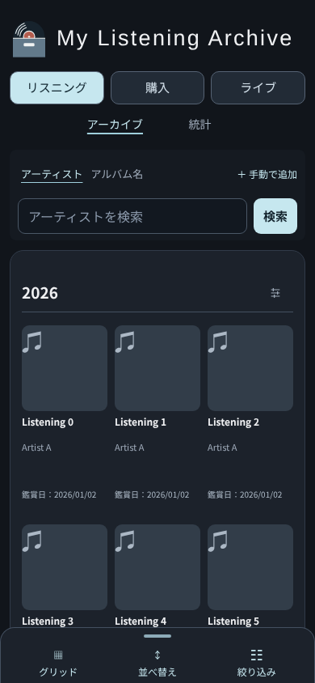 | 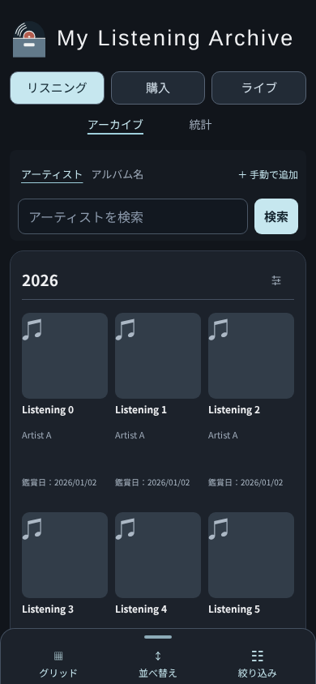 |
| collection | 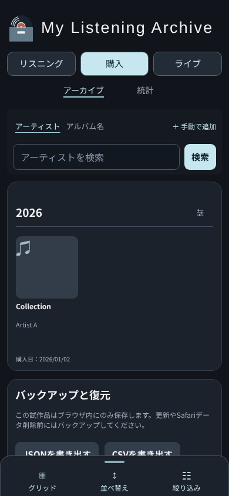 | 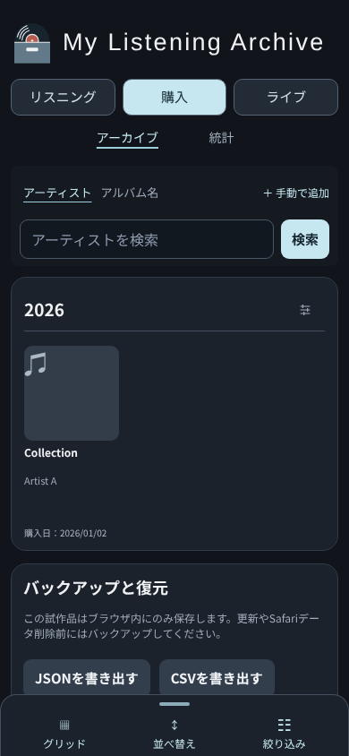 |
| live | 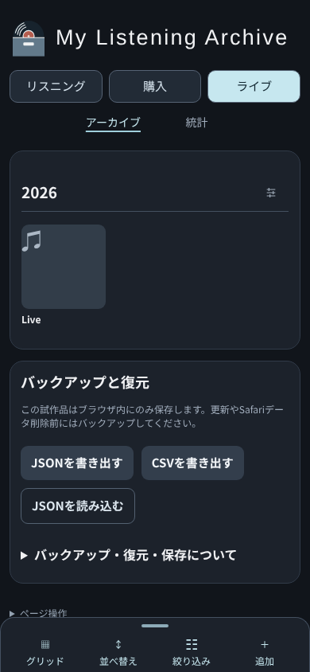 | 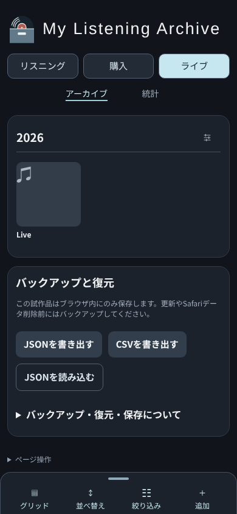 |
| language |  | 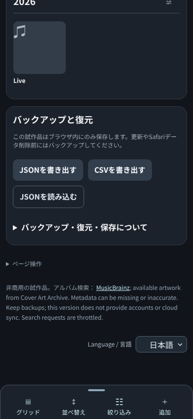 |

### chromium / en

| 画面 | 修正前 | 修正後 |
| --- | --- | --- |
| listening | 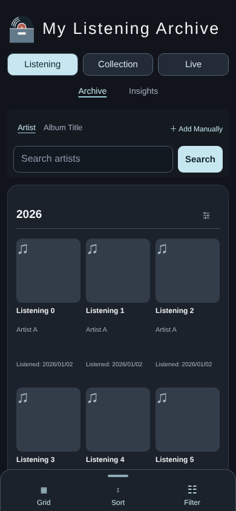 |  |
| collection | 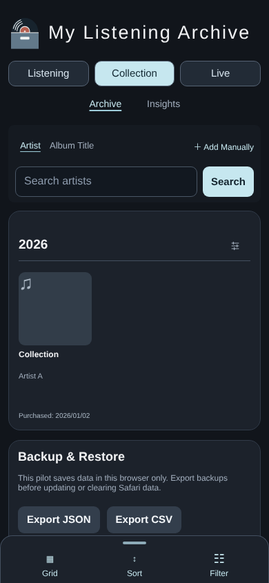 | 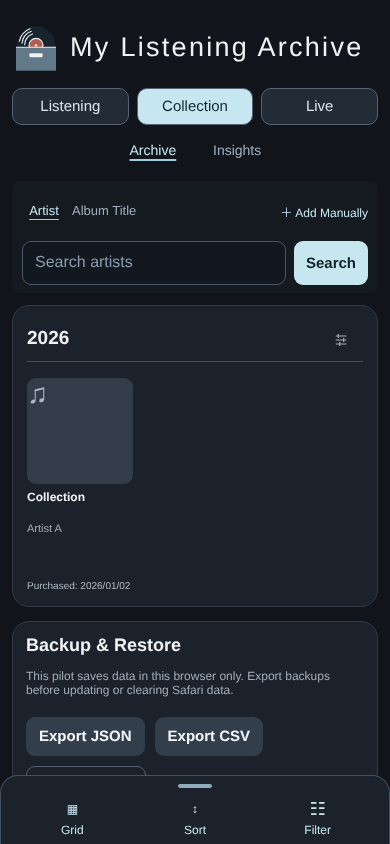 |
| live | 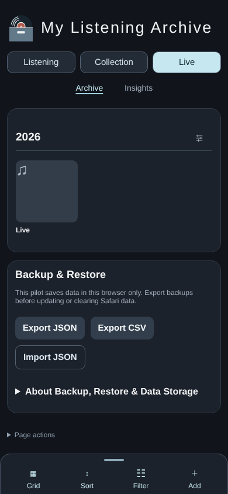 |  |
| language |  | 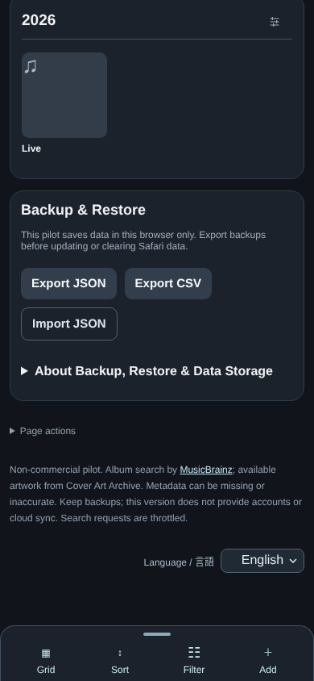 |

### webkit / ja

| 画面 | 修正前 | 修正後 |
| --- | --- | --- |
| listening | 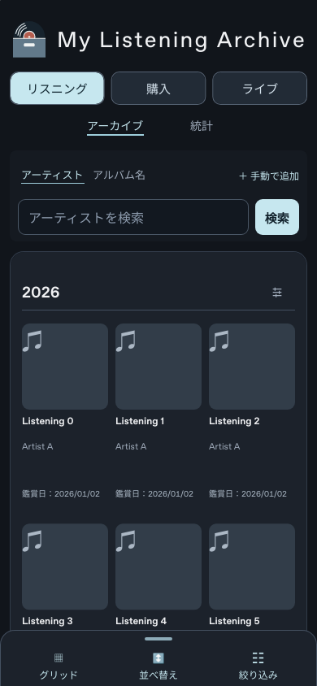 |  |
| collection | 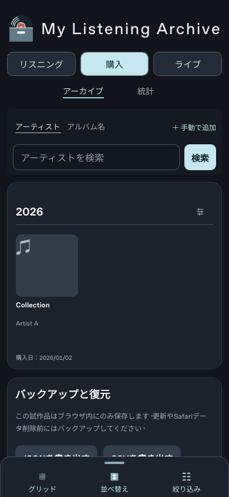 | 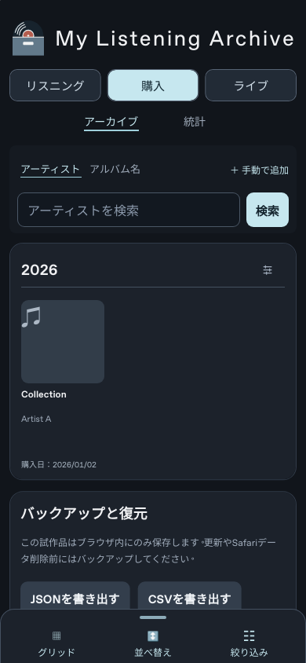 |
| live | 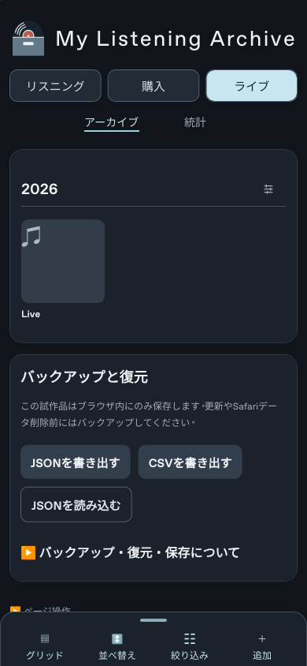 | 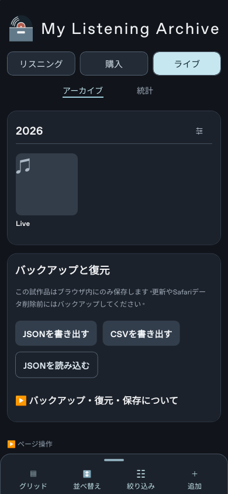 |
| language |  | 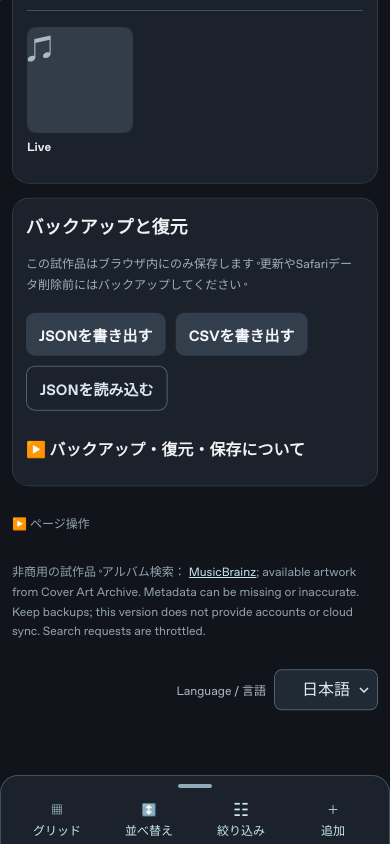 |

### webkit / en

| 画面 | 修正前 | 修正後 |
| --- | --- | --- |
| listening | 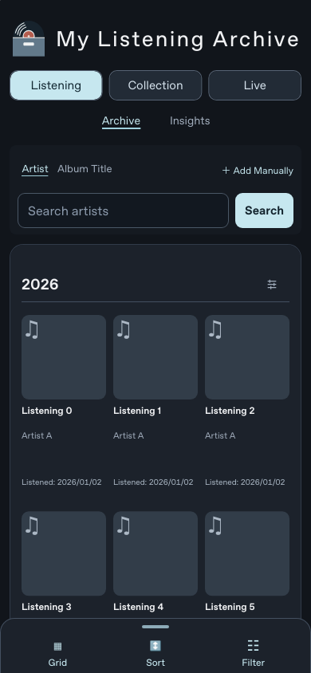 | 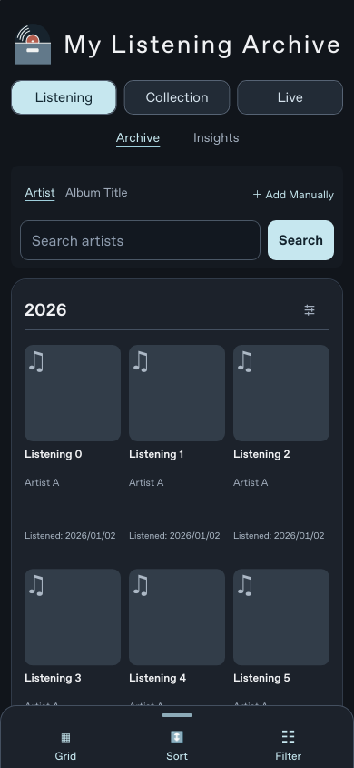 |
| collection | 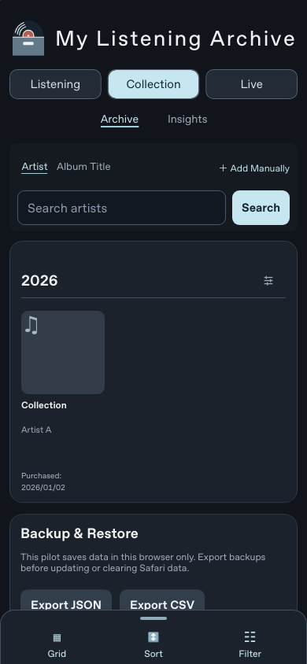 | 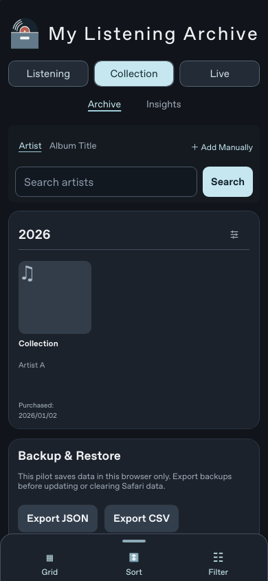 |
| live | 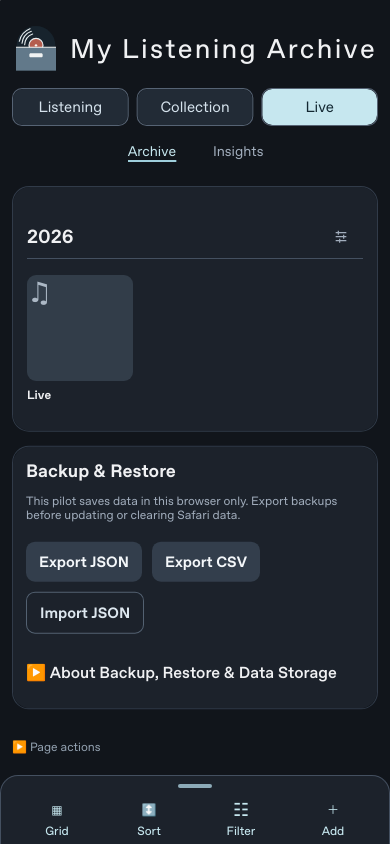 | 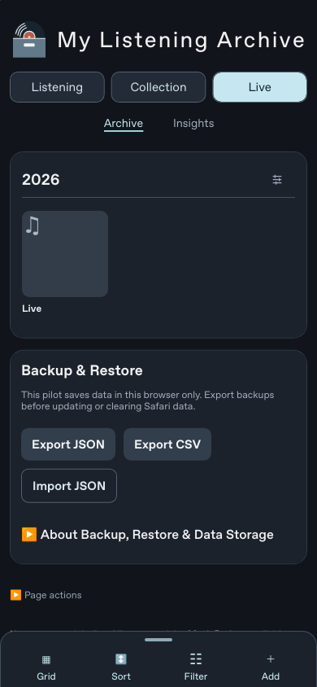 |
| language | 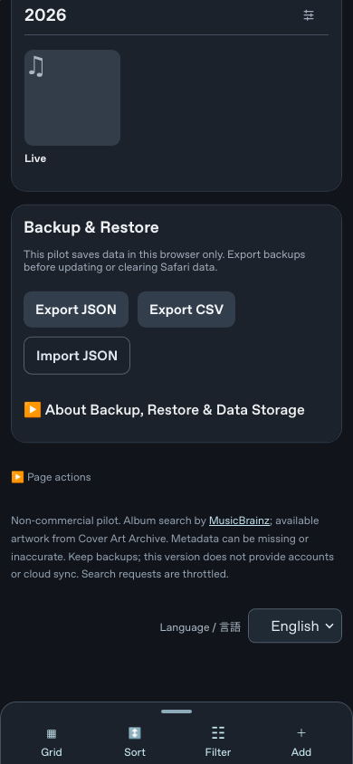 |  |

mainへのマージ・正式環境への反映は行わず、PRレビュー待ちとします。
