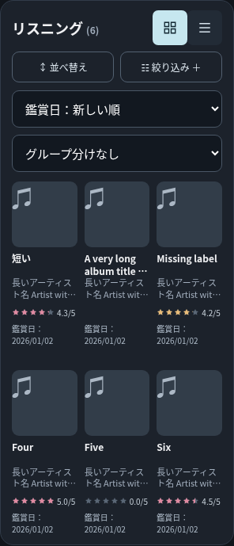
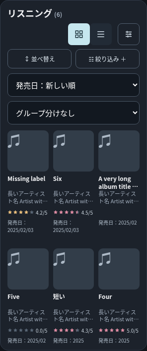
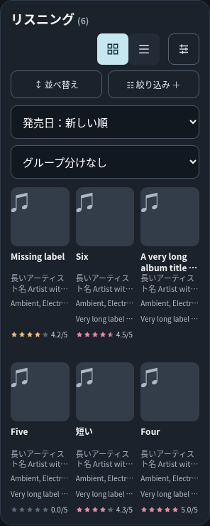

# 一覧表示カスタマイズ検証報告

追補：ヘッダーと設定画面の最終デザイン・再検証は [PR #35 追加修正報告](display-simplification-report.md) を参照。以下は初回提出時の記録（2段ヘッダー／二つの設定一覧は追加修正で廃止）。

実施日: 2026-11-10。基準main: `b6f6e435255f1af52a55fa3d75b4e2cd0c499d96`（PR #34反映後）。専用ブランチ: `feat/archive-display-options`。

## 実装とデザイン

Listening / Collection のグリッドだけに適用。固定のジャケット・タイトル・アーティストは変更せず、実在フィールド `rating/date/release/label/genre/tags`（Collection はさらに `format/store`）を0〜3項目選択し、44pxの上下ボタンで並べ替える。未登録値も同じ行を確保する。未評価スコアは既存と同じ空欄。複数値は既存パーサーを使用する。

初期状態とカスタム状態を区別した。初期状態は元の描画を維持し、日付行が並べ替えに連動する。リセットするとこの状態に戻る。カスタム状態では並べ替えにかかわらず指定順を維持する。タイトル・アーティストの既存2行固定領域、ジャケット、列数、列間隔、30pxのグリッド行間隔を維持。任意項目は18px高、上余白4pxの共通スロットに収め、長文を1行省略する。値のない行を繰り上げず、項目自体を解除すると全カードからその行を除く。星の生成処理・配色・数値・間隔は再利用する。

設定ボタンは切替群の外側に12px間隔で配置。320pxでは単一行を維持すると見出しと合計144pxの操作群が競合するため、380px以下では見出し／操作群の2段配置を採用した。文字やタップ領域を縮める案より読みやすく、既存の検索・並べ替え階層を保つ。Liveはこの配置変更の対象外。設定画面は既存の暗色モーダルに統一。上限時には未選択項目を無効化し件数で説明する。キーボードのフォーカス循環・Escape・閉じた後のフォーカス復帰に対応。

## 保存・互換性

新規キー `mma-ui-grid-display-v1` は既存DBキー `my-music-archive-pilot-v03`、旧DBキー、言語キーと衝突しない。アーカイブごとに配列（選択順）か `null`（初期状態）だけを保存。`[]` は0項目のカスタム状態。日英切替で保存フィールドIDは変えない。不正JSON、重複、未知フィールド、対象外フィールド、4項目以上、読み込み例外はアーカイブごとに初期状態へ戻す。書き込み失敗時はセッション中の表示を維持して説明を表示する。

DB version 3、レコード保存、バックアップ・復元、CSV、Insights、競合検出は変更していない。新規UI試験ではDBの保存文字列がバイト単位で変わらず、設定・並べ替え・言語・グリッド／リスト操作によるDB書き込みが0回であることを確認。設定保存の失敗注入時も同様。レコードに含むスコア、未登録フィールド、部分日付はそのまま保持する。

## 証跡・再実行

すべて隔離した合成データ、外部通信を遮断したChromiumで検証した。実機Safari試験ではない。

- `node --test tests/*.test.cjs`: 全151件成功（[ログ](display-options-evidence/node-tests.log)）。不正設定検証を追加。
- `python -u tests/display_options.py --baseline`: 指定mainのHTMLから基準画像を取得。実装前にも実行済み。
- `python -u tests/display_options.py`: 選択解除、0〜3項目、上限、上下移動、リセット、独立設定、再読込、言語切替、並べ替え・リストとの独立性、不正設定、保存例外、DB非変更を検証（[ログ](display-options-evidence/display-options.log)）。
- `python -u tests/display_defaults.py`: 日英×5幅×2アーカイブ×3並べ替えで、初期カードの相対座標・寸法・内容がmainと完全一致（[ログ](display-options-evidence/defaults.log)、[結果](display-options-evidence/default-comparison.json)）。
- [カスタム表示のDOM実測値](display-options-evidence/measurements.json): 全20条件のジャケット、カード、タイトル、アーティスト、各任意行、スコアの矩形。横方向のはみ出しなし、同一行の位置差1px未満、44px以上の設定ボタン。

画像は以下の規則で保存した。`area` は listening / collection、`lang` は ja / en、`width` は 320 / 375 / 390 / 430 / 1280。全20条件で取得。

|表示|ファイル名|
|---|---|
|変更前|`before-{area}-{lang}-{width}.png`|
|実装後・初期設定|`default-{area}-{lang}-{width}.png`|
|3項目・長文／複数ジャンル／欠損／スコア最後|`custom-{area}-{lang}-{width}.png`|
|設定モーダル|`modal-{area}-{lang}-{width}.png`|

さらに各アーカイブ・日英で0、1、2項目とスコア先頭の画像を取得（`zero-*`, `genre-count-*`, `label-count-*`, `score-first-*`）。

目視で320px日本語3行カード、320px英語Collectionモーダル、375px英語初期カード、1280px英語Collectionの3行カードを確認。長文による列幅拡張、スコア折返し、欠損による繰上げなし。モーダルは小画面で内部スクロール可能。

### 比較例（320px・日本語Listening）

変更前:

実装後・初期設定:

実装後・ジャンル、レーベル、スコア:

## 未検証事項

- iPhone Safari実機での最終視覚評価・実タッチ操作・VoiceOver。ユーザーによる最終確認が必要。
- Safariの実容量枯渇、OSによるタブ破棄、実IME入力。本検証の保存失敗は例外注入。
- 外部APIの実通信。本件の検索回帰試験は既存モックを使用。
- localStorage設定はブラウザ単位であり、他端末への同期・JSONバックアップへの包含は行わない。

マージ・手動デプロイは実施しない。①開発・検証ルーム #3 のレビューと実機評価を待つ。

## 既存回帰試験の全件実行結果

Node 151件成功。既存Pythonブラウザ33本をすべて実行し、最終的に29本成功、4本は基準mainでも同一箇所で失敗した。[全件初回結果](display-options-evidence/regressions/results.json)と各ログを同ディレクトリに格納した。`archive_insights` は最初に旧「見出し右側の単一行」期待値で失敗したため、本件の380px以下の2段配置に期待値を更新。Liveや通常幅では従来の検証を維持し、[再実行は全条件成功](display-options-evidence/regressions/archive_insights-recheck.log)。

成功した試験は、登録・編集・削除、詳細、Insights、検索モック、複合絞り込み、並べ替え、日英切替、JSONバックアップ／復元、CSV、保存失敗・別タブ競合、複数レーベル、Live会場サジェスト、写真・ドラフト処理を含む。`pr_a_browser` の必須項目144ケース、無効データ32ケース、ID・保存境界57シナリオも成功。

未解決の既存失敗（成功扱いにしない）:

|試験|現象|mainの再現ログ|
|---|---|---|
|collection_score_brand|過去版とのh2配列一致比較が320pxで失敗|[main](display-options-evidence/regressions/baseline-collection_score_brand.log)|
|integration_pr6_pr7|保存失敗の旧alertを期待するがalertがなく `alerts[-1]` で失敗|[main](display-options-evidence/regressions/baseline-integration_pr6_pr7.log)|
|pr_b_draft_review|Liveの処理済み写真を保持するケースで失敗（全36中35成功）|[main](display-options-evidence/regressions/baseline-pr_b_draft_review.log)|
|search_mode_light|現在はdivの `#search-modes` に対し旧select操作を実行して失敗|[main](display-options-evidence/regressions/baseline-search_mode_light.log)|

この4件の修正は本件に含めない。実機Safariとあわせ、レビュー時に既存課題として判断を依頼する。
