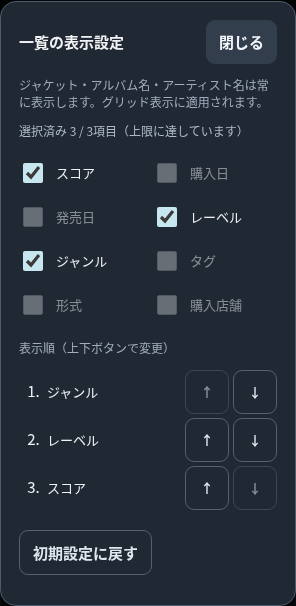
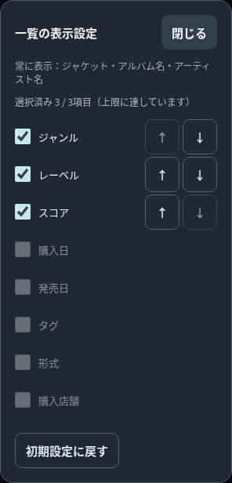

# PR #35 追加修正：ヘッダー・設定画面の簡素化

2026-11-10。変更前は同PRの `4adf87c9fca848fcb1bd7a09edff22c62890bfd5`。新規PRを作成せず、`feat/archive-display-options` を更新する。

## 最終デザイン

アーカイブの見出し・件数・グリッド／リスト・表示設定を1行へ戻した。380px以下の2段化を削除し、グリッド／リストの既存グループ、各44×44px、18pxアイコン、独立した設定ボタンまでの12px間隔を維持。320px付近（340px以下）だけ見出しを18→16px、件数を12→11px、見出しと操作群の最小間隔を8→4pxに調整した。375px以上の文字サイズは変えない。Liveにはこの文字サイズ変更を適用しない。カードの列幅やパネル余白を変更して収める方法は採用していない。

320pxの内幅266pxに対し操作群は144px。元の18px見出しでは、日本語Listening＋4桁件数が131.5pxとなり、8pxの間隔を含めると必要幅283.5pxで17.5px不足する。今回の最小調整では文字幅117.9375px＋操作144px＝261.9375pxとなり、実測4.0625pxの間隔を確保した。通常の6件表示では23.53125pxの余裕がある。横スクロールを隠して済ませず、文字の実際の矩形がボタンに重ならないことを検証した。

モーダルは単一のリストにした。選択済み項目を表示順に先頭へ配置し、チェックと上下ボタンを同じ行に表示。未選択項目はその下に配置する。新しく選ぶ項目は選択済み領域の末尾へ追加する。最大3件、解除時の残りの順序保持、初期設定への復帰を維持した。固定項目の説明を短縮し、別の表示順一覧・重複する項目名・操作説明・正常時のステータスを削除した。保存失敗時だけ説明する。

チェックはSpace、上下ボタンはEnterで操作できる。移動後も同じ項目にフォーカスを保持し、端に移動してボタンが無効になる場合は同じ行のチェックへ戻す。Tab循環・Escape・閉じた後の設定ボタンへのフォーカス復帰を維持した。

## 検証と証跡

隔離された合成データとChromiumを使用。外部通信は遮断。実機Safari試験ではない。

- [新規ブラウザ試験ログ](display-simplification-evidence/browser.log)：日英×320/375/390/430px×Listening/Collection、全16条件成功。
- [寸法の実測JSON](display-simplification-evidence/measurements.json)：見出しの文字領域、操作群、各ボタン、アイコン、4桁件数のストレス条件。全条件で1行、非重複、横はみ出しなし、操作44px以上、設定ボタンの間隔12px。
- 1項目1行のみで重複なし、上限時の無効化、解除・末尾追加、上下移動、キーボード、再読み込み後の保持、アーカイブ独立、初期設定復帰、設定保存失敗と復旧を全16条件で確認。
- 同一データ・同一条件の変更前後で、カスタムカードの幅・高さ・各情報の相対座標・表示内容が一致。
- 各条件の設定操作後、レコードDBの保存文字列が完全一致し、DB書き込み0回。設定キー・保存構造・初期表示と並べ替え連動・カード描画・レコード保存保護は変更していない。
- [Nodeログ](display-simplification-evidence/node-tests.log)：全151件成功。

関連ブラウザ試験の結果は末尾に記載する。

### 変更前後画像

各行のリンクには、見出しとモーダルの同条件比較を保存した（計64画像）。4桁件数はDOMだけを変更した寸法検証であり、記録を9999件生成したものではない。

|幅|言語|アーカイブ|ヘッダー|設定モーダル|
|---|---|---|---|---|
|320|ja|listening|[前](display-simplification-evidence/before-header-listening-ja-320.png) / [後](display-simplification-evidence/after-header-listening-ja-320.png)|[前](display-simplification-evidence/before-modal-listening-ja-320.png) / [後](display-simplification-evidence/after-modal-listening-ja-320.png)|
|320|ja|collection|[前](display-simplification-evidence/before-header-collection-ja-320.png) / [後](display-simplification-evidence/after-header-collection-ja-320.png)|[前](display-simplification-evidence/before-modal-collection-ja-320.png) / [後](display-simplification-evidence/after-modal-collection-ja-320.png)|
|320|en|listening|[前](display-simplification-evidence/before-header-listening-en-320.png) / [後](display-simplification-evidence/after-header-listening-en-320.png)|[前](display-simplification-evidence/before-modal-listening-en-320.png) / [後](display-simplification-evidence/after-modal-listening-en-320.png)|
|320|en|collection|[前](display-simplification-evidence/before-header-collection-en-320.png) / [後](display-simplification-evidence/after-header-collection-en-320.png)|[前](display-simplification-evidence/before-modal-collection-en-320.png) / [後](display-simplification-evidence/after-modal-collection-en-320.png)|
|375|ja|listening|[前](display-simplification-evidence/before-header-listening-ja-375.png) / [後](display-simplification-evidence/after-header-listening-ja-375.png)|[前](display-simplification-evidence/before-modal-listening-ja-375.png) / [後](display-simplification-evidence/after-modal-listening-ja-375.png)|
|375|ja|collection|[前](display-simplification-evidence/before-header-collection-ja-375.png) / [後](display-simplification-evidence/after-header-collection-ja-375.png)|[前](display-simplification-evidence/before-modal-collection-ja-375.png) / [後](display-simplification-evidence/after-modal-collection-ja-375.png)|
|375|en|listening|[前](display-simplification-evidence/before-header-listening-en-375.png) / [後](display-simplification-evidence/after-header-listening-en-375.png)|[前](display-simplification-evidence/before-modal-listening-en-375.png) / [後](display-simplification-evidence/after-modal-listening-en-375.png)|
|375|en|collection|[前](display-simplification-evidence/before-header-collection-en-375.png) / [後](display-simplification-evidence/after-header-collection-en-375.png)|[前](display-simplification-evidence/before-modal-collection-en-375.png) / [後](display-simplification-evidence/after-modal-collection-en-375.png)|
|390|ja|listening|[前](display-simplification-evidence/before-header-listening-ja-390.png) / [後](display-simplification-evidence/after-header-listening-ja-390.png)|[前](display-simplification-evidence/before-modal-listening-ja-390.png) / [後](display-simplification-evidence/after-modal-listening-ja-390.png)|
|390|ja|collection|[前](display-simplification-evidence/before-header-collection-ja-390.png) / [後](display-simplification-evidence/after-header-collection-ja-390.png)|[前](display-simplification-evidence/before-modal-collection-ja-390.png) / [後](display-simplification-evidence/after-modal-collection-ja-390.png)|
|390|en|listening|[前](display-simplification-evidence/before-header-listening-en-390.png) / [後](display-simplification-evidence/after-header-listening-en-390.png)|[前](display-simplification-evidence/before-modal-listening-en-390.png) / [後](display-simplification-evidence/after-modal-listening-en-390.png)|
|390|en|collection|[前](display-simplification-evidence/before-header-collection-en-390.png) / [後](display-simplification-evidence/after-header-collection-en-390.png)|[前](display-simplification-evidence/before-modal-collection-en-390.png) / [後](display-simplification-evidence/after-modal-collection-en-390.png)|
|430|ja|listening|[前](display-simplification-evidence/before-header-listening-ja-430.png) / [後](display-simplification-evidence/after-header-listening-ja-430.png)|[前](display-simplification-evidence/before-modal-listening-ja-430.png) / [後](display-simplification-evidence/after-modal-listening-ja-430.png)|
|430|ja|collection|[前](display-simplification-evidence/before-header-collection-ja-430.png) / [後](display-simplification-evidence/after-header-collection-ja-430.png)|[前](display-simplification-evidence/before-modal-collection-ja-430.png) / [後](display-simplification-evidence/after-modal-collection-ja-430.png)|
|430|en|listening|[前](display-simplification-evidence/before-header-listening-en-430.png) / [後](display-simplification-evidence/after-header-listening-en-430.png)|[前](display-simplification-evidence/before-modal-listening-en-430.png) / [後](display-simplification-evidence/after-modal-listening-en-430.png)|
|430|en|collection|[前](display-simplification-evidence/before-header-collection-en-430.png) / [後](display-simplification-evidence/after-header-collection-en-430.png)|[前](display-simplification-evidence/before-modal-collection-en-430.png) / [後](display-simplification-evidence/after-modal-collection-en-430.png)|

320px・日本語Listeningの修正前:

修正後:

320px・日本語Collectionのモーダル:

目視では上記に加え375px英語Listeningモーダルを確認。モーダル内で項目が重複せず、選択行の右側で上下操作が完結する。

## 未検証・レビュー依頼

iPhone Safari実機、VoiceOver、実タッチ操作、実容量枯渇は未検証。今回の保存失敗は例外注入。前回報告のmainでも再現する既存試験4本の問題は、本追加修正の範囲に含めない。

PR #35上で①開発・検証ルーム #3の再レビューを依頼する。マージ・手動デプロイは実施しない。

## 関連ブラウザ試験の最終結果

|試験|結果|ログ|
|---|---|---|
|display_options|成功|[ログ](display-simplification-evidence/display_options.log)|
|display_defaults|成功|[ログ](display-simplification-evidence/display_defaults.log)|
|archive_insights|成功|[ログ](display-simplification-evidence/archive_insights.log)|
|data_preservation|成功|[ログ](display-simplification-evidence/data_preservation.log)|
|save_failure_safety|成功|[ログ](display-simplification-evidence/save_failure_safety.log)|
|ui_v0322|成功|[ログ](display-simplification-evidence/ui_v0322.log)|
|unified_filters|成功|[ログ](display-simplification-evidence/unified_filters.log)|

全7本成功。[機械可読結果](display-simplification-evidence/related-results.json)。初期カードはmainとの日英×5幅×2アーカイブ×3並べ替え比較で一致（[結果](display-simplification-evidence/grid-default-comparison.json)）。グリッド／リスト、Insights切替、複合フィルター、登録・編集・削除、JSONバックアップ／復元、CSV、保存失敗と別タブ競合の既存保護を確認した。
