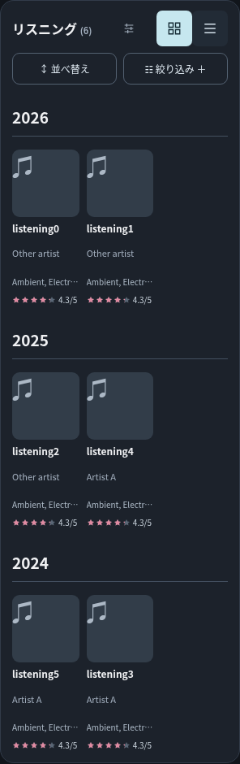
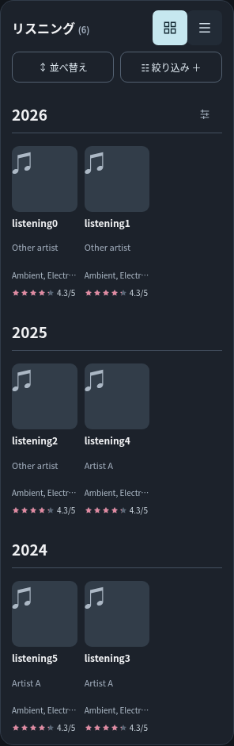
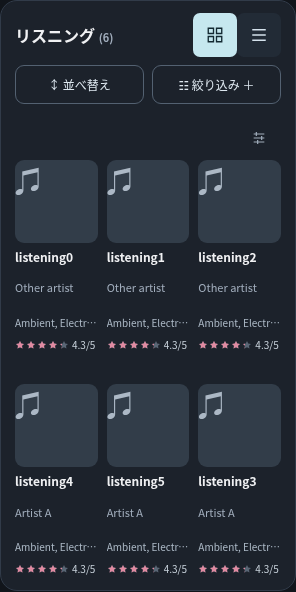
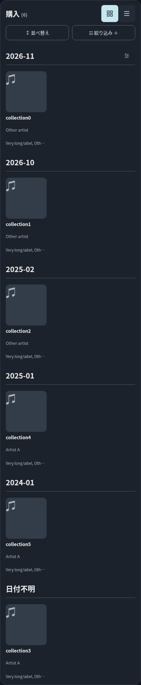
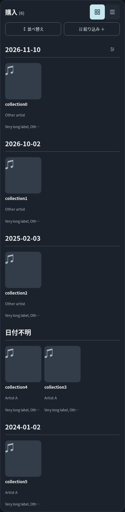
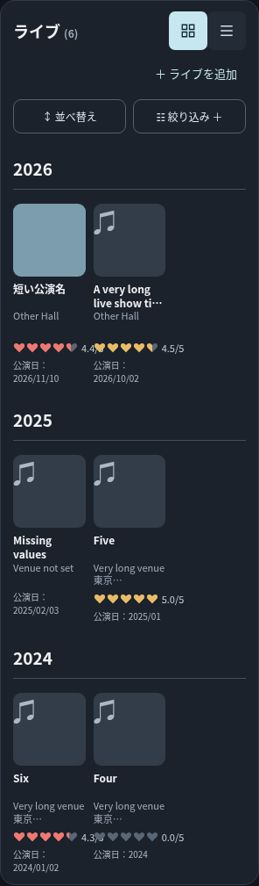
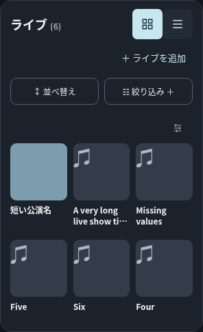
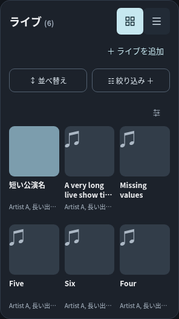
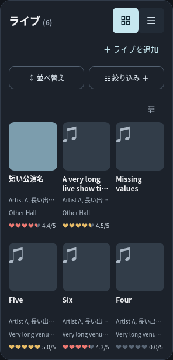
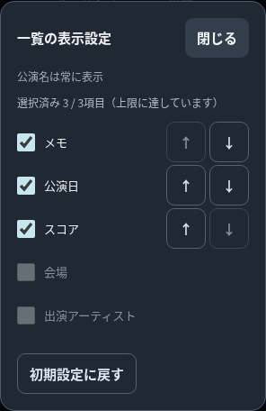

# 一覧表示設定の配置変更・Live対応 検証報告

2026-11-10。基準main: `79d2047a6110d4d7f5d9547962eccbf571695dcf`（PR #35統合後）。専用ブランチ: `feat/group-display-options-live`。

## 実装とデザイン

### 設定ボタンの移動

上部ヘッダーから設定ボタンを取り除き、3アーカイブともタイトル・件数は左、従来のグリッド／リストは右に配置した。ヘッダーの文字サイズ・背景・余白・切り替え群の外観を維持している。

設定ボタンは単一のDOMノードを保持し、描画時に最初のグループ見出しへ移動する。年・月・週・日、先頭グループの変化に対応。2番目以降には追加しない。グループなし、グループ対象外の並べ替え、記録0件、絞り込み0件では一覧先頭の専用行の右に置く。設定対象は常に現在のアーカイブ全体。リスト表示でも使用でき、InsightsではArchive領域ごと非表示になる。

16pxのスライダー、透明・枠なし・控えめな色、44×44pxの操作領域、日英の名前、キーボードフォーカス表示を維持。見出しのフォント・色・太さ・下線・上下余白は変更せず、最初の見出しだけ右52pxをボタンと文字の衝突防止に使う。ボタンは見出し内で右端・縦中央に置き、見出しの最小高さを44pxとした。実測ではグループ見出しとカード開始位置の差分は0〜1px。見出しのない専用行は仕様に従い44pxを追加する。

### Liveグリッド

写真／代替表示と公演名を保持し、公演名以外のテキストはすべて任意とした。初期状態は0項目で、会場名や日付・スコアは表示しない。公演名は2行分の領域を固定し、アルバムと同じ整列規則を使う。0項目では任意スロットを一切生成せず、公演名の2行領域以外に空の情報行を残さない。

選択可能な保存フィールドは `date / venue / artists / rating / memo`。出演者は既存 `artists[]` のみを使用し、公演名から推測しない。複数出演者・会場・メモは1行省略。空の値も18pxのスロットを保持し、他の項目を繰り上げない。日付は保存文字列の `-` を `/` に置換するだけで、年・年月・年月日の精度を維持する。詳細画面では出演者とメモの全文を確認できる。

スコアは既存の `ratingReadout` をそのまま使い、Liveのハート・色・0.0〜5.0・0.1刻み・未評価を維持。380px以下ではアルバムと同じコンパクトな寸法規則を適用して折り返しを防ぐ。写真の取得・保存・代替表示、Liveのグリッド列数・カード幅・グループ間隔は変更していない。

モーダルはPR #35の単一一覧を共有。Liveでは固定項目の説明だけを「公演名は常に表示」に切り替える。選択済みが先頭、未選択は下、追加は選択済み末尾、上下ボタン、最大3項目、リセット、キーボード操作は共通。

## 保存・データ保護

キーは既存 `mma-ui-grid-display-v1` のまま。既存の `{ listening: array|null, collection: array|null }` に `live: array` を追加する。Liveの初期・リセットは `[]`。Listening/Collectionの `null` は従来の並べ替え連動の初期表示を表し、この扱いは変更していない。

旧設定にLiveがなくてもアルバム側の配列・順序を保持し、Liveだけ `[]` として読む。不正JSON・重複・未知項目・別アーカイブ専用項目・4項目以上・読み込み例外はアーカイブごとの安全な初期値へ戻す。設定保存の例外は画面内で説明し、現在のセッションには反映する。

設定操作によるDB書き込みは0回。DBキー `my-music-archive-pilot-v03` とversion 3を維持し、保存済みartists配列・スコア・写真を変更しない。[ソース照合](group-display-live-evidence/data-protection-source.json)ではDB検証・書き込み・保護・競合処理、写真処理、JSON/CSV・復元処理、`insights.js`、`search.js` がmainと一致。ブラウザでもDB文字列の完全一致、設定独立、JSONバックアップ内容の完全一致を確認した。

## 検証結果

全試験は隔離された合成レコードとChromiumを使用し、外部通信を遮断。iPhone Safari実機試験ではない。

- [Nodeログ](group-display-live-evidence/node-tests.log)：全158件成功。旧形式の設定保持、Liveフィールドの独立した検証、不正Live設定の復帰を追加した。
- [新規配置・Live試験](group-display-live-evidence/browser.log)：日英×5幅×3アーカイブで年・月・週・日・なしの150条件、グループ対象外の並べ替え、複数グループ、絞り込み0件、リスト表示を確認。実記録0件も全幅で確認。ボタンが1個だけ存在し、44px以上で開閉できる。
- Liveの初期／0〜3項目、上下移動、解除後の順序、上限、保存・再読み込み、リセット、欠損、出演者配列、写真あり／なし、保存失敗時の安全性、DB書き込み0回を確認。
- [Live追加境界試験](group-display-live-evidence/live-edges.log)：日英×5幅で長いメモ・部分日付・ハート・欠損スロットをDOM実測。キーボードのSpace/Enter/Tab/Escape、フォーカス保持、不正設定、設定読み込み例外を確認。
- [mainとの比較](group-display-live-evidence/comparison.log)：日英×5幅で、両アルバムのカスタムカードの寸法・情報位置・内容が一致。全3アーカイブのリストHTML、写真サイズ・src・代替表示、InsightsのHTMLも一致。Liveカスタム設定が言語変更で失われず、JSONバックアップが元の記録と一致。
- [初期カード比較](group-display-live-evidence/display_defaults.log)：Listening/Collectionの初期カードはmainの日英×5幅×2アーカイブ×3並べ替え条件と一致。

### DOM実測

[配置とカードの実測JSON](group-display-live-evidence/measurements.json)に配置150条件とLive0〜3項目40条件を保存。[Liveメモ・部分日付の実測](group-display-live-evidence/live-edges.json)、[main比較の実測](group-display-live-evidence/comparison.json)も併記。カード幅・ジャケット正方形・公演名高さ・各任意行の位置を確認し、同じグリッド行での情報位置差は1px未満。長文・ハートのはみ出しと横スクロールなし。

Live初期の日本語先頭カード（写真サイズはmainと一致）:

|画面幅|ジャケット幅・高さ|公演名の領域高|任意行|
|---|---|---|---|
|320|82.66px|31.80px|0|
|375|101.00px|31.80px|0|
|390|106.00px|31.80px|0|
|430|119.33px|31.80px|0|
|1280|162.84px|34.44px|0|

### 既存関連ブラウザ試験

9本すべて成功。Liveスコアをグリッドで確認する既存2試験は、今回の「初期0項目」に合わせて設定からスコアを選ぶ前提を追加した。色や保存の期待値を緩めていない。既存表示設定試験のLiveボタン非表示の期待値も、新仕様の一覧内で表示へ更新した。

|試験|結果|
|---|---|
|display_options|[成功ログ](group-display-live-evidence/display_options.log)|
|display_defaults|[成功ログ](group-display-live-evidence/display_defaults.log)|
|archive_insights|[成功ログ](group-display-live-evidence/archive_insights.log)|
|data_preservation|[成功ログ](group-display-live-evidence/data_preservation.log)|
|save_failure_safety|[成功ログ](group-display-live-evidence/save_failure_safety.log)|
|ui_v0322|[成功ログ](group-display-live-evidence/ui_v0322.log)|
|live_artists_colors|[成功ログ](group-display-live-evidence/live_artists_colors.log)|
|multi_label_venue|[成功ログ](group-display-live-evidence/multi_label_venue.log)|
|unified_filters|[成功ログ](group-display-live-evidence/unified_filters.log)|

[機械可読結果](group-display-live-evidence/related-results.json)。`archive_insights` の初回起動は出力ディレクトリ未作成で失敗し、作成後に再実行して全条件成功した。製品コードの失敗ではない。

登録・編集・削除、Live出演者の追加編集、ハートの0/4.4/4.5/5/未評価、写真・ドラフト、JSONバックアップ・復元、CSV、保存失敗、別タブ競合、複合フィルター、複数レーベル、Live会場サジェストを既存試験で確認した。初回PR #35で報告したmainでも再現する旧試験4本は今回の対象外。過去ヘッダーにボタンがあることを固定した履歴用画像比較スクリプトは今回の仕様に適用しない。

## デザイン比較・提出画像

すべてMLAをChromiumで直接描画した未加工PNG。ヘッダーだけでなく、パネル全体とカードを含めて撮影した。mainとの比較60枚、3アーカイブの各グループ150枚、実記録0件30枚、Live初期／1〜3項目40枚、メモ・部分日付・モーダル20枚の計300枚を格納。

### Listening（320px・日本語）

main:

新しい年別見出し:

グループなし:

### Collection（月別・日別）

### Live（320px・日本語）

mainの旧表示:

初期：写真／代替表示と公演名のみ:

1項目（出演者）:

3項目（出演者・会場・ハート、未登録スロット含む）:

メモ・部分日付・ハート:

共有モーダル（Live）:

上記および390px英語の出演者1行表示を目視確認。グループの区切り線は連続し、2番目以降にボタンが増えない。Live初期は会場・日付・スコアを除いて簡潔にし、追加情報は共通スロットに整列する。

### 日英・5幅の全証跡

`area` は `listening / collection / live`、`lang` は `ja / en`、`width` は `320 / 375 / 390 / 430 / 1280`。

|対象|ファイル名|
|---|---|
|グループ5種類|`{area}-{lang}-{width}-{year|month|week|day|none}.png`|
|main比較|`{before|after}-{area}-{lang}-{width}-comparison.png`|
|記録0件|`empty-{area}-{lang}-{width}.png`|
|Live初期|`live-{lang}-{width}-default.png`|
|Live任意1〜3個|`live-{lang}-{width}-{1|2|3}-fields.png`|
|メモ・部分日付・ハート|`live-memo-date-heart-{lang}-{width}.png`|
|Liveモーダル|`live-modal-{lang}-{width}.png`|

## 未検証事項・レビュー

- iPhone Safari実機の視覚評価・実タッチ・VoiceOverは未検証。Chromiumの合成タッチ対応プロファイルとキーボード試験を実機とは区別する。
- 実機の容量枯渇・OSによるタブ破棄は未検証。設定読み書き失敗は例外注入。
- 実API通信は行わず、検索の回帰は既存モック試験／変更なしのソース照合による。
- 設定はブラウザ単位のUI状態。既存方針どおりJSONバックアップ・CSVへ追加しない。

新規レビュー用PRを提出し、①開発・検証ルーム #3の承認を待つ。マージ・手動デプロイは実施しない。
