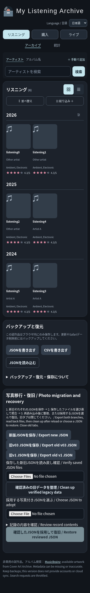
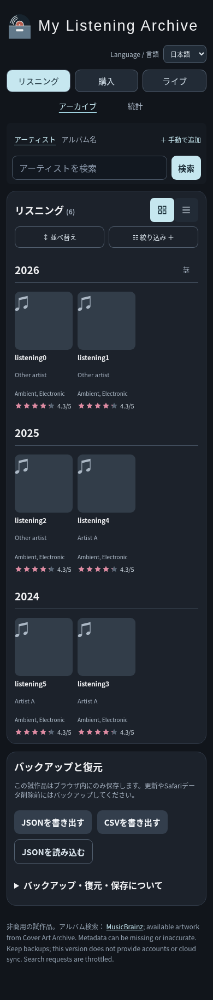

# 「写真移行・復旧」管理パネル撤去 検証報告

2026-11-12 UTC。①開発・検証ルーム #3 レビュー用。

基準main: `6bbe6e43ae9886674e2a51d0cc0b8b43ca330164`（PR #37マージ後）。作業ブランチ: `feat/remove-photo-maintenance`。提出前の再fetchでも同じmainであることを確認した。

## 変更結果と範囲

通常画面から管理パネルの生成関数・呼び出し・全10種のUIを削除した。非表示化・折りたたみ・別メニューへの移設ではなく、DOM自体を生成しない。新しい管理画面・常設パネルは設けていない。通常のJSON書き出し／読み込み、既存フッター、Listening／Collection／Live、Archive／Insights、検索・ソート・絞り込み・一覧カスタマイズのHTML/CSS・描画処理は維持した。

`photo-store.js`・`photo-lifecycle.js` は基準mainとバイト単位で同一。IndexedDB保存、写真ID、読み戻し照合、保存ロック、参照確定の順序、分岐検出、移行元指紋、整理ジャーナル、旧形式互換処理を変更していない。旧キーの削除や写真GCを呼び出す新経路は追加していない。既存の旧キーが残った状態で通常保存・JSON往復が成功することを確認した。

利用者から今回提示された、本番iPhone Safariでの新版読み込み・3領域の既存記録と写真表示・新版JSON保存と読み戻し照合・再読み込み後の保持完了を、管理パネルの役割終了の前提とした。今回の新コードをSafariで検証した証拠とは区別する。

## 先行調査と最小限の保護策

単純撤去では次の経路が失われると確認した。

1. 通常JSON書き出しは新版だけを出力するため、旧版との分岐時に旧側を退避できない。
2. 読み込み失敗時は通常の書き出し／読み込みが無効になる。従来の原本回収も1つの保存文字列だけで、IndexedDBの写真本体は含まない。
3. パネル以外に、全新旧JSONのファイル照合後、採用内容を明示選択して分岐から保存を再開する操作経路がない。

このため、**異常時だけ既存のバックアップ操作を使用する**最小対策を追加した。

|状態|操作・保護|
|---|---|
|正常|既存のJSON書き出し／読み込みを維持。version 3・全3領域・写真本体を含む。番号入力等は出ない。|
|分岐／読み込み停止中|既存「JSONを書き出す」でネイティブ入力ダイアログを表示。`0`=新版、`1`=旧v03、`2`=旧v1を個別にファイル保存できる。存在しない／壊れた保存元はエラーとなり、他の保存元は独立して退避可能。|
|分岐からの復旧|既存「JSONを読み込む」で、保存した新旧すべてのファイルを一緒に選ぶ。各ファイルを現在の保存元と照合し、採用するファイル番号と領域別件数・写真数をネイティブダイアログで確認する。別内容の編集済み候補を追加する場合も全現存保存元の照合が必要。バックアップ不足・キャンセル・保存元変更・ロック取得失敗・写真保存／参照保存失敗では元の新旧を保持する。|
|読み込み失敗でJSON化できない|既存のエラー表示内「読み込みできなかった保存データを回収」から `mla-recovery-sources.json` を保存する。新旧各キーの原文、起動時に取得した原文、参照から回収できた写真data URL、読めない写真・キーのエラーと並行更新有無を記録する。新モジュール `recovery-export.js` は保存・削除・復元を行わない。|
|壊れた保存元があり全照合できない|その場の上書き復旧は許可しない。読める側の写真付きJSONと原本回収ファイルを保持し、正常な写真付きJSONを別の隔離環境の通常JSON読み込みで復元する。元環境は消去しない。|

通常画面の操作ボタン数・配置・ラベルは変更していない。分岐通知と読み込み失敗通知の文面だけに、この経路への案内を加えた。失敗した入力が残る場合は従来どおり入力を保持し、入力を保全・明示破棄する前の全体復旧を拒否する。

原本回収ファイルは **version 3バックアップではない**。自動採用・自動統合しない。通常JSON読み込みに入れても拒否され、既存記録は変わらない。写真が既に欠けている／破損している／読み取り禁止の場合に、元の写真を生成し直す機能ではない。回収できない部分を明示し、原文と読める側を保全する。localStorage自体が読み取り禁止なら、取得不能な文字列の回収はできない。無関係なキー・未参照の写真は回収対象に含めない。

## 自動検証結果

使い捨てChromiumプロファイル、隔離ローカルHTTP、合成記録・生成画像のみで実施。外部HTTPS要求は遮断。本番Safariの保存領域は操作していない。

|検証|結果・証跡|
|---|---|
|通常画面からパネル・関連入力／ボタンが消失、フッター直接接続、横スクロールなし、日英・320/375/390/430/1280px・3領域・Archive/Insights|60条件すべて成功。[layout.log](remove-photo-maintenance-evidence/layout.log)、[DOM・寸法比較](remove-photo-maintenance-evidence/layout/comparison.json)|
|変更前後のページ全体画像|120枚を保存。全比較条件の前後PNGを後掲。390px日本語Listeningの前後と1280px英語Live Insightsは画像自体も目視確認。|
|PR #37の表示回帰：カード・写真・リスト・Insights、Live設定順序・再読み込み保持、他領域設定、記録保存文字列非変更|日英×5幅×3領域の30条件で成功。[display.log](remove-photo-maintenance-evidence/display.log)|
|3領域の新規登録・編集・削除、写真追加・差し替え・削除、写真付きJSONの実ダウンロード・読み込み・再読み込み|すべて成功。元記録の全フィールド・写真を保持。[crud.log](remove-photo-maintenance-evidence/crud.log)|
|IndexedDB写真保存失敗、写真読み戻し不一致、localStorage参照保存失敗、入力と選択ファイル保持、中断と再試行、別タブ更新、旧main復元、写真欠落時停止|PR #37の写真試験が成功。[photos.log](remove-photo-maintenance-evidence/photos.log)|
|旧キー整理の内部条件・ジャーナル失敗・削除途中中断、分岐復旧・保存ロック・復旧中更新・復旧保存失敗、合成容量上限|既存エンジン回帰成功。[recovery.log](remove-photo-maintenance-evidence/recovery.log)|
|移行元指紋保持、新版のみ編集後の整理条件、未取り込みキー保持、旧main分岐停止、復旧後の履歴再構築|既存エンジン回帰成功。[provenance.log](remove-photo-maintenance-evidence/provenance.log)|
|パネルのない本番コードの既存ボタンで、新旧退避・全照合・採用・再読み込み、照合不足／キャンセル／写真書き込み・参照保存失敗で両方保持|成功。[英語ログ](remove-photo-maintenance-evidence/stopped-controls.log)・[日本語ログ](remove-photo-maintenance-evidence/stopped-controls-ja.log)|
|IndexedDB読み出し失敗と破損写真の起動停止、新旧原文回収、正常写真のdata URL一致、読める旧側のJSON退避と別環境復元、回収ファイルの誤インポート拒否|成功。同上。元環境の保存文字列は変化なし。|
|原本回収時の一部キー読み取り失敗・一部写真欠落・原文解析不能・並行更新|新規Node試験で成功。読める部分を残し、取得不能と更新有無を記録。|
|既存Node全件＋新規2件|160/160成功。[node.log](remove-photo-maintenance-evidence/node.log)|
|全inline JS・写真モジュール・原本回収モジュール構文、git diff --check、写真保存2ファイルの基準一致|成功。[static.log](remove-photo-maintenance-evidence/static.log)|

### 既存試験の更新方針

`indexeddb_recovery.py` と `indexeddb_provenance.py` の削除済みボタン依存は、`tests/lifecycle_harness.py` が基準コミットから取り出す**テスト文書専用の旧操作部**に置き換えた。これは変更していない整理・復旧エンジンの複雑な異常系を引き続き実行するためで、アプリでは配信・呼び出し・表示しない。削除条件・競合検出・保存データ一致の期待値は緩めていない。

その試験だけでは新しい実操作経路の保証にならないため、`remove_photo_maintenance.py` で旧操作部を一切注入せず、実際のJSONボタンとファイル入力から退避・照合・復旧・失敗を別途確認した。`indexeddb_integration_display.py` は撤去済みパネルを起動完了判定に使用しないよう変更し、証跡出力先指定を追加した。

### 再実行

リポジトリルート、Python Playwrightと `/usr/bin/chromium` が必要。

```sh
node --test tests/*.test.cjs
python -u tests/indexeddb_photos.py
MLA_RECOVERY_EVIDENCE=docs/remove-photo-maintenance-evidence python -u tests/indexeddb_recovery.py
MLA_PROVENANCE_EVIDENCE=docs/remove-photo-maintenance-evidence python -u tests/indexeddb_provenance.py
python -u tests/indexeddb_integration_ui.py
MLA_DISPLAY_EVIDENCE=docs/remove-photo-maintenance-evidence python -u tests/indexeddb_integration_display.py
python -u tests/remove_photo_maintenance.py
python -u tests/remove_photo_maintenance_layout.py
git diff --check
```

## 未完了・レビュー依頼

- **DP-08（実容量不足）、大量写真保存時の性能、不要写真の容量回収（GC）は継続課題。** 合成容量上限・例外注入の成功を実容量不足の完了とは扱わない。写真の削除・差し替え後の古いIndexedDB写真は従来どおり残る。
- Safari実機・VoiceOver・実タッチ・OS電源断・ブラウザのストレージ消去は今回未検証。新しい異常時経路では、Safariの複数ファイル選択とネイティブ入力ダイアログが追加確認箇所。必要なら隔離合成データで新旧JSONを各1ファイル退避→複数選択→番号採用→再読み込み・写真表示確認の最小ケースを実施する。本番データで分岐を作らない。
- ロックを共有しない任意の旧版との同時操作は従来の制約を維持。旧タブを閉じて退避・復旧する。全保存元を照合できない場合、その場の上書きはできない。
- 旧キー／移行ロジックの廃止・旧キー整理の再公開は今回の対象外。利用者向け整理UIは撤去し、内部ロジックは別案件で判断できるよう保持した。

①開発・検証ルーム #3へ、パネル完全撤去と異常時の既存バックアップ操作による最小保護策のレビューを依頼する。新規PRを提出し、今回の承認前にはマージしない。手動デプロイは行わない。

## 全画面比較画像

加工・切り抜きのないChromiumのページ全体PNG。各リンクは変更前／変更後。代表画像:





|言語・幅|Listening Archive|Collection Archive|Live Archive|Listening Insights|Collection Insights|Live Insights|
|---|---|---|---|---|---|---|
|ja 320px|[前](remove-photo-maintenance-evidence/layout/before-listening-archive-ja-320.png) / [後](remove-photo-maintenance-evidence/layout/after-listening-archive-ja-320.png)|[前](remove-photo-maintenance-evidence/layout/before-collection-archive-ja-320.png) / [後](remove-photo-maintenance-evidence/layout/after-collection-archive-ja-320.png)|[前](remove-photo-maintenance-evidence/layout/before-live-archive-ja-320.png) / [後](remove-photo-maintenance-evidence/layout/after-live-archive-ja-320.png)|[前](remove-photo-maintenance-evidence/layout/before-listening-insights-ja-320.png) / [後](remove-photo-maintenance-evidence/layout/after-listening-insights-ja-320.png)|[前](remove-photo-maintenance-evidence/layout/before-collection-insights-ja-320.png) / [後](remove-photo-maintenance-evidence/layout/after-collection-insights-ja-320.png)|[前](remove-photo-maintenance-evidence/layout/before-live-insights-ja-320.png) / [後](remove-photo-maintenance-evidence/layout/after-live-insights-ja-320.png)|
|ja 375px|[前](remove-photo-maintenance-evidence/layout/before-listening-archive-ja-375.png) / [後](remove-photo-maintenance-evidence/layout/after-listening-archive-ja-375.png)|[前](remove-photo-maintenance-evidence/layout/before-collection-archive-ja-375.png) / [後](remove-photo-maintenance-evidence/layout/after-collection-archive-ja-375.png)|[前](remove-photo-maintenance-evidence/layout/before-live-archive-ja-375.png) / [後](remove-photo-maintenance-evidence/layout/after-live-archive-ja-375.png)|[前](remove-photo-maintenance-evidence/layout/before-listening-insights-ja-375.png) / [後](remove-photo-maintenance-evidence/layout/after-listening-insights-ja-375.png)|[前](remove-photo-maintenance-evidence/layout/before-collection-insights-ja-375.png) / [後](remove-photo-maintenance-evidence/layout/after-collection-insights-ja-375.png)|[前](remove-photo-maintenance-evidence/layout/before-live-insights-ja-375.png) / [後](remove-photo-maintenance-evidence/layout/after-live-insights-ja-375.png)|
|ja 390px|[前](remove-photo-maintenance-evidence/layout/before-listening-archive-ja-390.png) / [後](remove-photo-maintenance-evidence/layout/after-listening-archive-ja-390.png)|[前](remove-photo-maintenance-evidence/layout/before-collection-archive-ja-390.png) / [後](remove-photo-maintenance-evidence/layout/after-collection-archive-ja-390.png)|[前](remove-photo-maintenance-evidence/layout/before-live-archive-ja-390.png) / [後](remove-photo-maintenance-evidence/layout/after-live-archive-ja-390.png)|[前](remove-photo-maintenance-evidence/layout/before-listening-insights-ja-390.png) / [後](remove-photo-maintenance-evidence/layout/after-listening-insights-ja-390.png)|[前](remove-photo-maintenance-evidence/layout/before-collection-insights-ja-390.png) / [後](remove-photo-maintenance-evidence/layout/after-collection-insights-ja-390.png)|[前](remove-photo-maintenance-evidence/layout/before-live-insights-ja-390.png) / [後](remove-photo-maintenance-evidence/layout/after-live-insights-ja-390.png)|
|ja 430px|[前](remove-photo-maintenance-evidence/layout/before-listening-archive-ja-430.png) / [後](remove-photo-maintenance-evidence/layout/after-listening-archive-ja-430.png)|[前](remove-photo-maintenance-evidence/layout/before-collection-archive-ja-430.png) / [後](remove-photo-maintenance-evidence/layout/after-collection-archive-ja-430.png)|[前](remove-photo-maintenance-evidence/layout/before-live-archive-ja-430.png) / [後](remove-photo-maintenance-evidence/layout/after-live-archive-ja-430.png)|[前](remove-photo-maintenance-evidence/layout/before-listening-insights-ja-430.png) / [後](remove-photo-maintenance-evidence/layout/after-listening-insights-ja-430.png)|[前](remove-photo-maintenance-evidence/layout/before-collection-insights-ja-430.png) / [後](remove-photo-maintenance-evidence/layout/after-collection-insights-ja-430.png)|[前](remove-photo-maintenance-evidence/layout/before-live-insights-ja-430.png) / [後](remove-photo-maintenance-evidence/layout/after-live-insights-ja-430.png)|
|ja 1280px|[前](remove-photo-maintenance-evidence/layout/before-listening-archive-ja-1280.png) / [後](remove-photo-maintenance-evidence/layout/after-listening-archive-ja-1280.png)|[前](remove-photo-maintenance-evidence/layout/before-collection-archive-ja-1280.png) / [後](remove-photo-maintenance-evidence/layout/after-collection-archive-ja-1280.png)|[前](remove-photo-maintenance-evidence/layout/before-live-archive-ja-1280.png) / [後](remove-photo-maintenance-evidence/layout/after-live-archive-ja-1280.png)|[前](remove-photo-maintenance-evidence/layout/before-listening-insights-ja-1280.png) / [後](remove-photo-maintenance-evidence/layout/after-listening-insights-ja-1280.png)|[前](remove-photo-maintenance-evidence/layout/before-collection-insights-ja-1280.png) / [後](remove-photo-maintenance-evidence/layout/after-collection-insights-ja-1280.png)|[前](remove-photo-maintenance-evidence/layout/before-live-insights-ja-1280.png) / [後](remove-photo-maintenance-evidence/layout/after-live-insights-ja-1280.png)|
|en 320px|[前](remove-photo-maintenance-evidence/layout/before-listening-archive-en-320.png) / [後](remove-photo-maintenance-evidence/layout/after-listening-archive-en-320.png)|[前](remove-photo-maintenance-evidence/layout/before-collection-archive-en-320.png) / [後](remove-photo-maintenance-evidence/layout/after-collection-archive-en-320.png)|[前](remove-photo-maintenance-evidence/layout/before-live-archive-en-320.png) / [後](remove-photo-maintenance-evidence/layout/after-live-archive-en-320.png)|[前](remove-photo-maintenance-evidence/layout/before-listening-insights-en-320.png) / [後](remove-photo-maintenance-evidence/layout/after-listening-insights-en-320.png)|[前](remove-photo-maintenance-evidence/layout/before-collection-insights-en-320.png) / [後](remove-photo-maintenance-evidence/layout/after-collection-insights-en-320.png)|[前](remove-photo-maintenance-evidence/layout/before-live-insights-en-320.png) / [後](remove-photo-maintenance-evidence/layout/after-live-insights-en-320.png)|
|en 375px|[前](remove-photo-maintenance-evidence/layout/before-listening-archive-en-375.png) / [後](remove-photo-maintenance-evidence/layout/after-listening-archive-en-375.png)|[前](remove-photo-maintenance-evidence/layout/before-collection-archive-en-375.png) / [後](remove-photo-maintenance-evidence/layout/after-collection-archive-en-375.png)|[前](remove-photo-maintenance-evidence/layout/before-live-archive-en-375.png) / [後](remove-photo-maintenance-evidence/layout/after-live-archive-en-375.png)|[前](remove-photo-maintenance-evidence/layout/before-listening-insights-en-375.png) / [後](remove-photo-maintenance-evidence/layout/after-listening-insights-en-375.png)|[前](remove-photo-maintenance-evidence/layout/before-collection-insights-en-375.png) / [後](remove-photo-maintenance-evidence/layout/after-collection-insights-en-375.png)|[前](remove-photo-maintenance-evidence/layout/before-live-insights-en-375.png) / [後](remove-photo-maintenance-evidence/layout/after-live-insights-en-375.png)|
|en 390px|[前](remove-photo-maintenance-evidence/layout/before-listening-archive-en-390.png) / [後](remove-photo-maintenance-evidence/layout/after-listening-archive-en-390.png)|[前](remove-photo-maintenance-evidence/layout/before-collection-archive-en-390.png) / [後](remove-photo-maintenance-evidence/layout/after-collection-archive-en-390.png)|[前](remove-photo-maintenance-evidence/layout/before-live-archive-en-390.png) / [後](remove-photo-maintenance-evidence/layout/after-live-archive-en-390.png)|[前](remove-photo-maintenance-evidence/layout/before-listening-insights-en-390.png) / [後](remove-photo-maintenance-evidence/layout/after-listening-insights-en-390.png)|[前](remove-photo-maintenance-evidence/layout/before-collection-insights-en-390.png) / [後](remove-photo-maintenance-evidence/layout/after-collection-insights-en-390.png)|[前](remove-photo-maintenance-evidence/layout/before-live-insights-en-390.png) / [後](remove-photo-maintenance-evidence/layout/after-live-insights-en-390.png)|
|en 430px|[前](remove-photo-maintenance-evidence/layout/before-listening-archive-en-430.png) / [後](remove-photo-maintenance-evidence/layout/after-listening-archive-en-430.png)|[前](remove-photo-maintenance-evidence/layout/before-collection-archive-en-430.png) / [後](remove-photo-maintenance-evidence/layout/after-collection-archive-en-430.png)|[前](remove-photo-maintenance-evidence/layout/before-live-archive-en-430.png) / [後](remove-photo-maintenance-evidence/layout/after-live-archive-en-430.png)|[前](remove-photo-maintenance-evidence/layout/before-listening-insights-en-430.png) / [後](remove-photo-maintenance-evidence/layout/after-listening-insights-en-430.png)|[前](remove-photo-maintenance-evidence/layout/before-collection-insights-en-430.png) / [後](remove-photo-maintenance-evidence/layout/after-collection-insights-en-430.png)|[前](remove-photo-maintenance-evidence/layout/before-live-insights-en-430.png) / [後](remove-photo-maintenance-evidence/layout/after-live-insights-en-430.png)|
|en 1280px|[前](remove-photo-maintenance-evidence/layout/before-listening-archive-en-1280.png) / [後](remove-photo-maintenance-evidence/layout/after-listening-archive-en-1280.png)|[前](remove-photo-maintenance-evidence/layout/before-collection-archive-en-1280.png) / [後](remove-photo-maintenance-evidence/layout/after-collection-archive-en-1280.png)|[前](remove-photo-maintenance-evidence/layout/before-live-archive-en-1280.png) / [後](remove-photo-maintenance-evidence/layout/after-live-archive-en-1280.png)|[前](remove-photo-maintenance-evidence/layout/before-listening-insights-en-1280.png) / [後](remove-photo-maintenance-evidence/layout/after-listening-insights-en-1280.png)|[前](remove-photo-maintenance-evidence/layout/before-collection-insights-en-1280.png) / [後](remove-photo-maintenance-evidence/layout/after-collection-insights-en-1280.png)|[前](remove-photo-maintenance-evidence/layout/before-live-insights-en-1280.png) / [後](remove-photo-maintenance-evidence/layout/after-live-insights-en-1280.png)|
