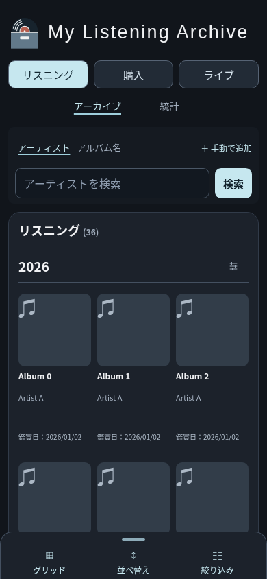
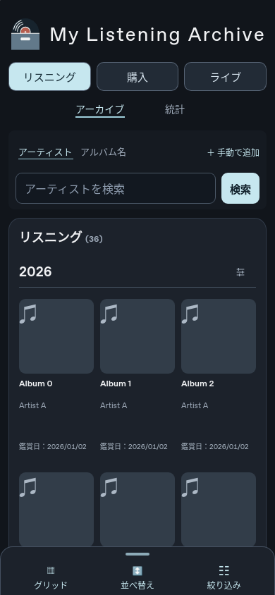
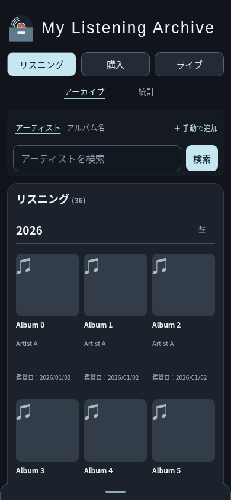
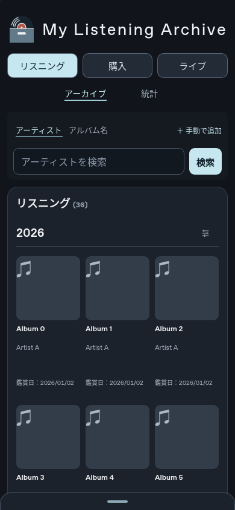
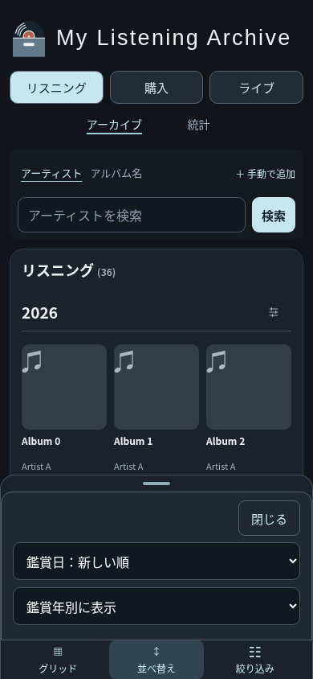
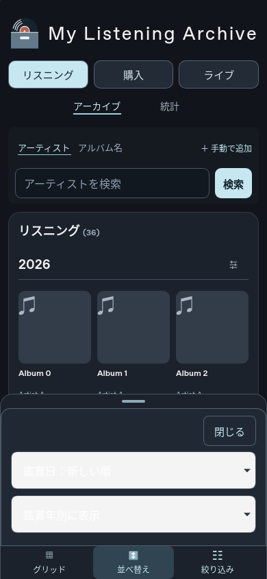

# MLA 収納式下部バー・操作修正・言語移設 報告

## 対象と変更範囲

PR #47 はマージ済みであることを確認し、最新main `58d6733210574ccca8b55ea48d979c9c62510d9c` から `fix/retractable-toolbar` を作成しました。

変更は `archive-toolbar.js`、`archive-toolbar.css`、`index.html` の言語欄移動、および検証コード・証跡に限定しています。IndexedDB、JSON、移行・復旧、CRUD、検索、統計、並べ替え／フィルター条件、スワイプ、Pull to Refresh、先頭ボタンの400px判定と3秒タイマーは変更していません。

## 実装

- 上部角を18pxで丸め、中央に短いハンドルを設置。通常69px、収納29px（いずれもセーフエリアは別途）。操作は従来どおり3つ／Liveのみ4つです。
- ハンドルの下方向スワイプで収納、上方向スワイプ・タップ・Enter・Spaceで展開。ハンドルの縦位置と操作列の高さを180msで控えめに変化させ、本文のバー用余白も同時に40px縮小します。`prefers-reduced-motion` ではアニメーションを無効にします。
- ハンドルの見た目は通常20px／収納28px。幅88px、縦44pxの透明なヒット領域を上側へ確保しています。収納中の操作列は `inert` と非表示で、Tab／支援技術の対象から外します。展開状態と操作名は `aria-expanded`／日英の `aria-label` で提供します。収納状態はセッション内だけのUI状態で、保存方式を追加していません。
- ジェスチャー処理はハンドルのPointer Eventsだけに限定。ハンドル上の横ドラッグでは状態を変えず、アーカイブの既存タッチ処理には変更を加えていません。
- 統計／モーダル中はバーと本文のバー用余白を除去。先頭へ戻るボタンのオフセットは、選択パネル・収納アニメーションを含むバーの実測高へ追従します。
- 言語欄は既存のlabel／selectを注意書きの直後へ移設。selectのID、イベント、即時反映、保存方式はそのままです。元の場所には要素・余白を残していません。検索欄・タブ群・カードは変更していません。

## 不具合の原因と修正

空白パネルは、前回のDOM移設後、内側の `sort-wrap`／`filters-wrap` の状態変化を外側コンテナが常に監視していなかったことに起因する同期漏れです。パネル共通の `syncPanels()` と内側classの監視を追加し、既存の `closeSort()`／`closeFilter()` を再利用して外側まで閉じます。閉じる・外側タップ・Escape、領域切替・統計・モーダル・収納の各経路で同期させます。

並べ替え押下時のselect自動展開につながる、パネル内selectへの `.focus()` を除去しました。ポインター操作時は起動ボタンにフォーカスを残します。キーボード／支援技術による起動では「閉じる」にフォーカスし、次のTabでselectへ進めます。開閉自体は値・条件を変更しません。

## 検証

ChromiumとLinux WebKitを、新規コンテキスト・合成アーカイブ・外部通信遮断で検証しました。390×844を重点に、1280×844と日本語／英語も確認しています。

| 検証 | 結果 |
| --- | --- |
| ハンドルのタップ・上下ドラッグ・Enter／Space | 両エンジン・両幅・日英 PASS |
| 収納時に本文paddingとバー高さが69→29pxへ縮小 | PASS（セーフエリア0で測定） |
| 横方向のハンドルドラッグ、アーカイブの左右スワイプ・縦移動 | PASS（自動イベント／ポインター） |
| 3領域の並べ替え→絞り込み→閉じるを各3回反復 | PASS |
| 閉じるボタン・外側タップ・Escapeの各経路 | PASS、外枠と高さの復帰を確認 |
| 内側パネルだけにhiddenを付ける旧不具合の再現操作 | PASS、外側も閉じ空白なし |
| 開く際にselectへプログラムフォーカスを送らないこと | PASS（focus呼出しを計測） |
| キーボード起動→閉じる→Tabでselect→Escapeで起動ボタンへ戻る | PASS |
| 並べ替え・グループ・ジャンル／店舗／会場フィルターの保持 | PASS |
| 言語欄が注意書きより後ろに1つだけ存在／即時反映・再読込保持 | PASS |
| 上部言語欄の除去とタブがブランド直下へ詰まること | PASS |
| 統計・モーダル時の非表示とバー用padding除去 | PASS |
| 展開／収納それぞれの先頭ボタンの非重複 | PASS |
| 最下部の言語select全体がバーより上に表示できること | PASS |
| reduced-motionでハンドルのtransitionが0s | PASS |
| 既存archive_toolbar.py（高さ期待値のみ更新） | 両エンジン・両幅 PASS |
| 既存mobile_navigation.py：CRUD／JSON往復／復旧保護／先頭ボタン／スワイプ | 両エンジン PASS |
| 既存pull_refresh_modes.py：通常／standalone／display-modeの4条件 | 両エンジン PASS |
| 既存Node回帰試験 | 164件 PASS |
| `git diff --check` | PASS |

[検証ログ](validation.txt)

再実行：

```sh
node --test tests/*.test.cjs
python -u tests/retractable_toolbar.py
python -u tests/archive_toolbar.py
python -u tests/mobile_navigation.py
python -u tests/pull_refresh_modes.py
```

必要に応じ `MLA_WEBKIT=/path/to/pw_run.sh` を指定します。今回のWebKitは前回と同じ一時領域の独立バンドルを利用しました。

## スクリーンショット

実データや外部アートワークは使用していません。合成データのプレースホルダー画像です。通常／収納の比較は同じListening・同じスクロール位置です。

| 390px 日本語 | Chromium | WebKit |
| --- | --- | --- |
| 通常 |  |  |
| 収納 |  |  |
| 並べ替え |  |  |

英語版、1280px版、Collection／Liveの並べ替えもこのディレクトリ内にあります（40枚）。

## 未検証・残存リスク

- iPhone実機で、収納時に3列×4段＝12枚のアルバムアートを撮影できるかは未検証です。今回保証できるのはバー用余白の40px縮小と上部言語領域の除去であり、実機の画面高・ブラウザツールバー・表示項目・スクロール位置による撮影枚数は自動試験では保証していません。
- iPhone実機のセーフエリア、ネイティブselectが初回タップで自動展開しないこと、VoiceOver読み上げ・操作、日本語IME／ソフトウェアキーボード、Safari／ホーム画面でのネイティブジェスチャーは未検証です。selectへのフォーカス呼出し除去とLinux上の挙動確認は、iOS実機検証の代用にはなりません。
- コンパクトなハンドルは44pxの透明ヒット領域を上側へ持ちます。その領域の使いやすさも実機レビューの対象です。

専用ブランチとPRで提出し、mainへのマージ・正式環境への反映は行いません。
